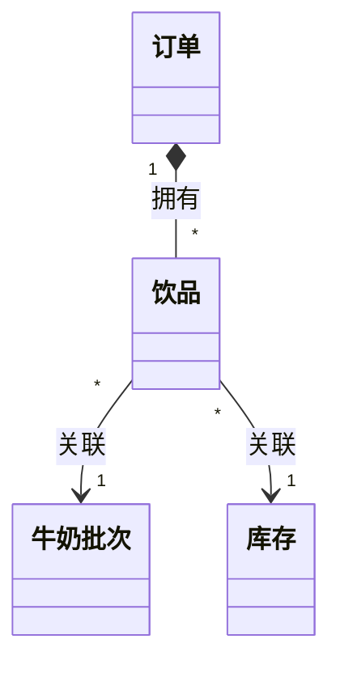

# GOAL 研究：一杯客人满意的甜牛奶

> 这是一份教学 + 案例：前半讲 DDD 的工作坊要产出什么，后半用牛奶这个例子从头做一遍。
> 需求金字塔在 [GOAL-milk.md](./GOAL-milk.md)；这份文件只讲模型是怎么来的、合不合格。

## 一、这份文档教什么

事件风暴工作坊的目标，原文说得很清楚：

> 通过事件来追溯整个软件当中关键行为发生来确定系统当中状态的变化。找出体现系统状态变化的模型，或者我们可以叫实体，从而分析出我们的整个领域模型，对这些模型的划分……最终得到模块或者服务的划分和映射方式。

所以工作坊不是讲故事，是产出模型：事件 → 实体 → 领域模型 → 模块或服务的划分。

## 二、合格的模型长什么样

原文没有给分数，给的是几条原则。

**模型视图要简洁。** 13 篇：

> 模型，是用来表达和理解复杂的软件业务的，简洁明了意味着信息的丢失……想看清系统业务结构基本元素需要：上下文、模型、关系、聚合、实体值对象。

> 属性。过于细节，不利于模型的维护……工作坊的中间产物。比如事件、角色等信息，如果需要表达，可以使用其他图形来表达，否则含混不清。

**聚合要封装不变性。** 18 篇：

> 聚合是一组相关领域模型的集合，是用来封装业务的不变性。

**聚合还有几条硬约束。** 19 篇：

> 1. 当一个实体被多个聚合根使用时，需要将其设计为聚合根或者将其拆开。
> 2. 不允许使用中间表处理多对多关系，探明多对多原因，明确中间模型的归属。
> 3. 区分关联和拥有。
> 5. 聚合的层级保持在 2 级，最多不超过 3 级。
> 10. 让合适的人做合适的决策，并做好决策记录。

**上下文要是相对独立的能力。** 17 篇：

> 显式定义概念来统一语言。
> 聚合可以用于定义业务一致性的基本单位。
> 限界上下文可以用来定义相对独立能力的基本单位。

合起来，一份研究文档合格的标准是：

```
1. 能画出一张模型视图：上下文、聚合、实体、关系，不含属性和中间产物
2. 每个聚合能一句话说清它保证哪条不变性
3. 聚合满足单一根、不超过三层、无共享实体、多对多中间模型有归属
4. 每个上下文能独立说清提供什么能力，词不打架
5. 事件、命令作为中间产物单独放，不混进模型视图
6. 重要取舍有记录
```

下面用牛奶这个例子，把这几条走一遍。

## 三、案例：事件和命令（中间产物）

**事件**要写状态改变，不写点击。18 篇：

> 捕获我们所建模的领域中所发生过的事情，会对系统产生影响的事情。

> 表达事件最好的方式是，描述系统的某个状态被改变。

牛奶的 24 条事件：

```
点单   订单创建 / 订单被拒 / 订单修改
取奶   牛奶取出 / 取奶失败 / 换批完成
加甜   甜味加入 / 加甜被拒 / 甜度复判完成
混合   混合完成 / 混合失败 / 重搅完成
调温   温度达标 / 温度不符 / 温度调整完成
装杯   装杯完成 / 装杯失败 / 换杯完成
交付   交付完成 / 交付超时 / 订单取消
品尝   客人认可 / 客人拒收 / 重做完成
```

**命令**要有来源。18 篇：

> 命令有三类来源：用户的动作、第三方系统、定时器。

> 为什么要分析命令？分析命令可以对事件的触发源进行分析，从而分析出系统中的角色。

牛奶的命令：点单、改单、取消（客人）；取奶、换批、加甜、复判甜度、搅拌、重搅、调温、调温补正、封杯、换杯、交付、重做（店员）；品尝确认（客人）。

按 13 篇的规矩，这些事件和命令只作为中间产物，不画进后面的模型视图。

## 四、案例：模型

**实体和值对象。** 02 篇：

> 实体是领域模型面向对象语言的具体体现，一般是一个类。实体可以使用 ID 标识。

> 值对象是一种特殊的实体，但一般认为没有自己的状态和生命周期。值对象是用属性标识，任何属性的变化都视为新的对象。

牛奶里：

```
实体   订单、饮品、牛奶批次
值对象 甜度、温度、封口状态、杯况
```

**聚合与聚合根。** 02 篇：

> 聚合是一组生命周期一致的实体集合，表达统一的业务意义。

> 聚合根是聚合中最核心的对象……聚合中有且只有一个聚合根。

按 19 篇的硬约束检查，牛奶得到三个聚合：

```
聚合一：订单（根）+ 饮品
  不变性：订单内饮品的甜度、温度必须一致
  约束检查：一个根；两层；无共享实体

聚合二：牛奶批次（根）
  不变性：过期批次不可用
  约束检查：独立聚合；只与饮品关联，不被拥有

聚合三：库存（根：糖、杯）
  不变性：余量低于阈值必须补货，不能出现负库存
  约束检查：一个根；两层
```

**模型视图**（不含属性，只画上下文、聚合、实体、关系）：



## 五、案例：上下文

限界上下文是相对独立的能力（17 篇），同一套词、同一套规则。牛奶划分成七个：

```
奶源   能力：保证批次合格、取用可控      模型：牛奶批次     词：批次、保质期
甜味   能力：保证糖可食用、甜度可控      模型：甜度         词：甜度、勺数
混合   能力：保证搅匀、不洒出            模型：饮品         词：结块、分层
温度   能力：保证温度符合选择            模型：温度         词：冰、常温、热
外观   能力：保证端上桌状态正常          模型：饮品         词：分层、表面
包装   能力：保证杯子与封口合格          模型：杯况、封口    词：封口、渗漏
出杯   能力：保证按时交付并被客人认可    模型：订单         词：订单、交付、认可
```

边界检查：外观和包装都涉及装杯，按“谁负责保证哪条结果”拆开——包装保证封口，外观只做端上桌的人工检查，不挂事件。

## 六、案例：统一语言

02 篇：

> 通用语言是指在软件设计中，业务人员和开发人员需要使用无歧义的统一语言来对话。

```
客人   点单并付钱的人
订单   一次点单，有编号和状态
饮品   一杯具体的甜牛奶，属于订单
批次   一盒鲜奶或一罐奶粉，有保质期
甜度   糖的种类与勺数
温度   冰、常温、热三档
封口   平整、不歪、不渗
认可   客人尝过，说满意
```

一个词只在一个上下文里有一个意思；“用户”这个词不出现在牛奶里。

## 七、合格判定：六条逐条过

```
1. 模型视图       有：上下文、聚合、实体、关系；无属性、无事件
2. 聚合不变性     三个聚合，各一句话说清保证什么
3. 聚合硬约束     单一根、两层、无共享实体、多对多没有中间表
4. 上下文能力     七个上下文各一句话说清能力，词不打架
5. 中间产物隔离   事件 24 条、命令 17 条单独列，不进模型视图
6. 决策记录       代糖不做、外观不挂事件、品尝归出杯，都写在这里
```

## 八、决策记录

```
1. 代糖不算甜味来源：本项目只做含糖版本，无糖另开需求
2. 外观不挂事件：它是对包装结果的检查，不是独立能力
3. 品尝归出杯：认可与拒收决定这单是否完成，属于交付能力
4. 重做超过两次终止：避免无限返工，作为业务规则写进 REQ
```

## 九、从模型到需求

```
聚合的不变性    → REQ（例如订单内甜度、温度一致）
命令的前置条件  → REQ（例如已倒奶才能加甜）
命令的拒绝条件  → AC 的异常场景（例如超过两勺被拒）
成功事件        → AC 的正常场景
每条 AC         → 一条用例
```

按这个映射，七个上下文得到 12 条 REQ。要什么、做到没有，看 [GOAL-milk.md](./GOAL-milk.md)。
