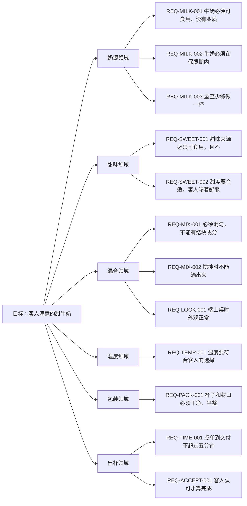

# 目标树（示例：一杯客人满意的甜牛奶）

> 这是示例，不是本项目的需求。研究见 [GOAL-milk-research.md](./GOAL-milk-research.md)。
> 它只有两样：一张图，一棵文字金字塔；材料和取舍都在研究里。

## 一、金字塔（图）

## 二、文字金字塔

- **目标**：做出一杯客人满意的甜牛奶
  - **奶源领域**（解决：奶从哪来、够不够、新不新鲜）
    - **REQ-MILK-001 必要条件：牛奶必须可食用、没有变质**
      - AC：Given 一盒鲜奶 When 闻气味、看状态 Then 没有异味、没有絮状物
        - 用例：TC-MILK-001-a 取 200 毫升鲜奶，闻气味、看状态          预期无异味无絮状物     结果 通过
      - AC：Given 一盒鲜奶 When 倒进透明杯 Then 颜色均匀，没有沉淀
        - 用例：TC-MILK-001-b 两勺奶粉兑 200 毫升水，搅匀后看状态      预期无结块             结果 通过
      - AC：Given 两勺奶粉兑 200 毫升水 When 搅匀 Then 没有结块
        - 用例：TC-MILK-001-c 故意用有酸味的鲜奶                       预期判为不可用         结果 失败（判为不可用）
      - AC：Given 一盒过期鲜奶 When 检查日期、闻气味 Then 判为不可用
        - 用例：TC-MILK-001-d 取有酸味的鲜奶，闻气味                 预期判为不可用       结果 失败（判为不可用）
      - AC：Given 一盒有酸味的鲜奶 When 检查 Then 判为不可用
        - 用例：TC-MILK-001-e 取受潮结块的奶粉，冲兑                   预期判为不可用       结果 失败（判为不可用）
      - AC：Given 奶粉受潮结块 When 冲兑 Then 判为不可用
        - 用例：TC-MILK-001-f 取颜色异常的鲜奶，看状态                 预期判为不可用       结果 失败（判为不可用）
    - **REQ-MILK-002 必要条件：牛奶必须在保质期内**
      - AC：Given 一盒鲜奶 When 查看包装日期 Then 在标注日期内
        - 用例：TC-MILK-002-a 查看鲜奶包装日期                         预期在标注日期内       结果 通过
      - AC：Given 一罐奶粉 When 查看开封日期 Then 在一周内
        - 用例：TC-MILK-002-b 查看奶粉开封日期                         预期一周内             结果 通过
      - AC：Given 一盒过期鲜奶 When 检查日期 Then 不得使用
        - 用例：TC-MILK-002-c 取一盒过期鲜奶，检查日期                 预期不可用             结果 失败（判为不可用）
      - AC：Given 开封超过一周的奶粉 When 检查 Then 不得使用
        - 用例：TC-MILK-002-d 取开封超过一周的奶粉，检查                 预期不可用             结果 失败（判为不可用）
    - **REQ-MILK-003 必要条件：量至少够做一杯**
      - AC：Given 一个量杯 When 倒入鲜奶 Then 至少 200 毫升
        - 用例：TC-MILK-003-a 量杯量取 200 毫升                        预期至少 200 毫升      结果 通过
      - AC：Given 奶粉 When 冲兑 Then 到 200 毫升刻度
        - 用例：TC-MILK-003-b 余量只剩 100 毫升时点单                   预期提前告知、不接单   结果 失败（拒单）
      - AC：Given 余量只剩 100 毫升 When 接单前检查 Then 提前告知，不接单
        - 用例：TC-MILK-003-c 余量只剩 100 毫升时点单                   预期拒单             结果 失败（拒单）
      - AC：Given 奶粉只剩一勺 When 冲兑 Then 不够一杯，不接单
        - 用例：TC-MILK-003-d 奶粉只剩一勺时冲兑                         预期不够一杯、拒单   结果 失败（拒单）
  - **甜味领域**（解决：甜不甜、甜得合不合适）
    - **REQ-SWEET-001 必要条件：甜味来源必须可食用，且不破坏能不能喝**
      - AC：Given 一杯牛奶 When 加一勺白糖 Then 仍然能喝
        - 用例：TC-SWEET-001-a 加一勺白糖搅匀，尝一口                   预期仍能喝             结果 通过
      - AC：Given 一杯牛奶 When 加一勺蜂蜜 Then 仍然能喝
        - 用例：TC-SWEET-001-b 加一勺蜂蜜搅匀，尝一口                   预期仍能喝             结果 通过
      - AC：Given 一杯牛奶 When 加一勺炼乳 Then 仍然能喝
        - 用例：TC-SWEET-001-c 加一勺炼乳搅匀，尝一口                   预期仍能喝             结果 通过
      - AC：Given 一杯牛奶 When 加代糖 Then 不算本轮的甜味来源，拒绝
        - 用例：TC-SWEET-001-d 加代糖，尝一口                           预期不算甜味来源、拒绝 结果 失败（拒绝）
      - AC：Given 一杯牛奶 When 加变质的糖浆 Then 判为不可用
        - 用例：TC-SWEET-001-e 加变质糖浆，尝一口                         预期判为不可用       结果 失败（判为不可用）
    - **REQ-SWEET-002 必要条件：甜度要合适，客人喝着舒服**
      - AC：Given 200 毫升牛奶 When 加一勺糖 Then 客人说甜度合适
        - 用例：TC-SWEET-002-a 200 毫升牛奶加一勺糖，请客人尝           预期合适               结果 通过
      - AC：Given 200 毫升牛奶 When 加两勺糖 Then 客人仍说可以接受
        - 用例：TC-SWEET-002-b 200 毫升牛奶加三勺糖，请客人尝           预期太甜               结果 失败（判为过甜）
      - AC：Given 200 毫升牛奶 When 加三勺糖 Then 客人说太甜
        - 用例：TC-SWEET-002-c 200 毫升牛奶加三勺糖，请客人尝             预期太甜             结果 失败（判为过甜）
      - AC：Given 200 毫升牛奶 When 不加糖 Then 客人说寡淡，补加半勺
        - 用例：TC-SWEET-002-d 200 毫升牛奶不加糖，请客人尝               预期寡淡、补半勺     结果 失败（补糖后通过）
      - AC：Given 加糖后发苦 When 复判 Then 判为不合格，重做
        - 用例：TC-SWEET-002-e 加糖后发苦，复判                           预期不合格、重做     结果 失败（重做）
  - **混合领域**（解决：匀不匀、洒不洒、端上桌好不好看）
    - **REQ-MIX-001 必要条件：必须混匀，不能有结块或分层**
      - AC：Given 牛奶和糖 When 用打蛋器搅 10 秒 Then 没有结块
        - 用例：TC-MIX-001-a 打蛋器搅 10 秒，静置看状态               预期无结块             结果 通过
      - AC：Given 牛奶和糖 When 用筷子搅 30 秒 Then 没有结块
        - 用例：TC-MIX-001-b 筷子搅 30 秒，静置看状态                 预期无结块             结果 通过
      - AC：Given 牛奶和糖 When 盖盖摇晃 15 秒 Then 没有结块
        - 用例：TC-MIX-001-c 盖盖摇晃 15 秒，静置看状态               预期无结块             结果 通过
      - AC：Given 搅好的奶 When 静置五分钟 Then 不分层
        - 用例：TC-MIX-001-d 搅拌不足，检查杯底                         预期有结块、重搅       结果 失败（重搅后通过）
      - AC：Given 搅拌不足 When 检查杯底 Then 有结块
        - 用例：TC-MIX-001-e 搅拌不足，检查杯底                           预期有结块           结果 失败（重搅后通过）
      - AC：Given 静置后分层 When 检查 Then 判为不合格
        - 用例：TC-MIX-001-f 静置后分层，检查                             预期不合格、重做     结果 失败（重做）
      - AC：Given 连续两次重搅仍结块 When 检查 Then 重做，不再继续搅
        - 用例：TC-MIX-001-g 连续两次重搅仍结块，检查                     预期重做             结果 失败（重做）
    - **REQ-MIX-002 必要条件：搅拌时不能洒出来**
      - AC：Given 倒到八分满 When 搅拌 Then 不溢出
        - 用例：TC-MIX-002-a 倒到八分满再搅                           预期不溢出             结果 通过
      - AC：Given 倒到七分满 When 摇晃 Then 不溢出
        - 用例：TC-MIX-002-b 倒到满杯再搅                             预期溢出               结果 失败（溢出不收）
      - AC：Given 倒到满杯 When 搅拌 Then 溢出，判为不合格，倒掉重来
        - 用例：TC-MIX-002-c 倒到满杯再搅                                 预期溢出             结果 失败（倒掉重来）
      - AC：Given 杯盖没盖紧 When 摇晃 Then 渗出，换杯
        - 用例：TC-MIX-002-d 杯盖没盖紧，摇晃                             预期渗出             结果 失败（换杯）
    - **REQ-LOOK-001 必要条件：端上桌时外观正常**
      - AC：Given 做好的牛奶 When 看表面 Then 没有结块
        - 用例：TC-LOOK-001-a 端上桌前看表面                           预期无结块             结果 通过
      - AC：Given 做好五分钟 When 再看 Then 不分层
        - 用例：TC-LOOK-001-b 放五分钟再看                             预期不分层             结果 通过
      - AC：Given 表面有泡沫堆积 When 看表面 Then 撇掉再交付
        - 用例：TC-LOOK-001-c 静置后分层，看表面                       预期重搅               结果 失败（重搅后通过）
      - AC：Given 静置后分层 When 看表面 Then 重搅
        - 用例：TC-LOOK-001-d 静置后分层，看表面                           预期重搅             结果 失败（重搅后通过）
  - **温度领域**（解决：凉的热的）
    - **REQ-TEMP-001 必要条件：温度要符合客人的选择**
      - AC：Given 两块冰 When 测温度 Then 是凉的
        - 用例：TC-TEMP-001-a 加两块冰，测温度                         预期是凉的             结果 通过
      - AC：Given 室温放置 When 测温度 Then 不凉
        - 用例：TC-TEMP-001-b 室温放置，测温度                         预期不凉               结果 通过
      - AC：Given 加热到 50 度 When 测温度 Then 是温的
        - 用例：TC-TEMP-001-c 加热到 50 度，测温度                     预期是温的             结果 通过
      - AC：Given 客人要冰的 When 测温度 Then 是常温，补冰
        - 用例：TC-TEMP-001-d 客人要冰的却给常温，测温度               预期不符、补冰         结果 失败（补正后通过）
      - AC：Given 补冰后 When 复测 Then 仍不达标，重做
        - 用例：TC-TEMP-001-e 补冰后复测                                   预期仍不达标、重做   结果 失败（重做）
  - **包装领域**（解决：杯子干不干净、封没封好）
    - **REQ-PACK-001 必要条件：杯子和封口必须干净、平整**
      - AC：Given 一只空杯 When 检查杯身和杯口 Then 没有污渍、没有缺口
        - 用例：TC-PACK-001-a 用前检查杯身、杯口                       预期无污渍无缺口       结果 通过
      - AC：Given 装好的一杯 When 检查封口 Then 封膜平整、不歪、不渗
        - 用例：TC-PACK-001-b 封口后按压检查                           预期平整不渗           结果 通过
      - AC：Given 杯身有污渍 When 检查 Then 换杯
        - 用例：TC-PACK-001-c 故意用有污渍的杯，检查                   预期换杯               结果 失败（换杯后通过）
      - AC：Given 封口歪斜 When 检查 Then 重新封
        - 用例：TC-PACK-001-d 封口歪斜，检查                           预期重封               结果 失败（重封后通过）
      - AC：Given 封口渗漏 When 倒置检查 Then 换杯重封
        - 用例：TC-PACK-001-e 封口渗漏，倒置检查                           预期换杯重封         结果 失败（换封后通过）
  - **出杯领域**（解决：等多久、先来后到、客认不认可）
    - **REQ-TIME-001 必要条件：点单到交付不超过五分钟**
      - AC：Given 一位客人点单 When 计时到交付 Then 不超过 5 分钟
        - 用例：TC-TIME-001-a 从点单开始计时，交付时停表               预期不超过五分钟       结果 通过
      - AC：Given 三位客人排队 When 按顺序交付 Then 先到先得
        - 用例：TC-TIME-001-b 三人同时点单，记录交付顺序               预期先到先得           结果 通过
      - AC：Given 拖到六分钟 When 交付 Then 记录超时并向客人说明
        - 用例：TC-TIME-001-c 故意拖到六分钟，交付                     预期记超时             结果 失败（记超时）
      - AC：Given 售罄 When 客人点单 Then 拒单并告知
        - 用例：TC-TIME-001-d 材料清零后点单                           预期拒单               结果 失败（拒单）
      - AC：Given 客人中途取消 When 订单取消 Then 不再制作
        - 用例：TC-TIME-001-e 客人中途取消，订单取消                       预期不再制作         结果 失败（取消）
    - **REQ-ACCEPT-001 必要条件：客人认可才算完成**
      - AC：Given 客人尝过 When 说满意 Then 这单完成
        - 用例：TC-ACCEPT-001-a 请客人尝，记录认可                      预期完成               结果 通过
      - AC：Given 客人尝过 When 说太甜 Then 重做后再确认
        - 用例：TC-ACCEPT-001-b 客人拒收，重做，再请客人尝               预期第二次认可         结果 通过（第二次认可）
      - AC：Given 重做一次后 When 客人仍不满意 Then 再重做一次
        - 用例：TC-ACCEPT-001-c 连续两次重做后仍拒收                     预期终止并说明         结果 失败（终止）
      - AC：Given 同一单重做两次 When 客人仍不满意 Then 终止并说明
        - 用例：TC-ACCEPT-001-d 同一单重做两次，客人仍拒收                   预期终止并说明       结果 失败（终止）
  - **充分路径**：每条 REQ 取一条 AC，得到一条完整路径
    - 路径 A：鲜牛奶 + 白糖 + 筷子 + 常温 + 干净杯，五分钟内交付
    - 路径 B：奶粉冲兑 + 蜂蜜 + 打蛋器 + 冰 + 封口平整，五分钟内交付
    - 路径 C：鲜牛奶 + 炼乳 + 摇晃 + 加热 + 干净杯，五分钟内交付
  - **验收**：客人尝过，说甜度合适、温度对、没有结块、包装没问题、没等太久
