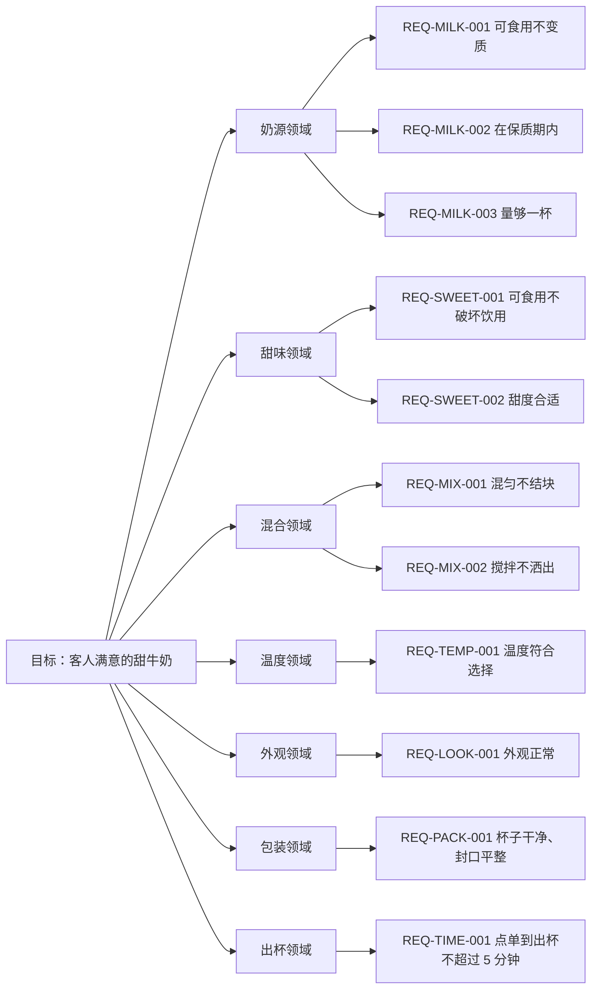

# 目标树（示例：一杯客人满意的甜牛奶）

> 这是示例，不是本项目的需求。它和正式的 GOAL 一样，只有两张东西：一张图，一棵文字金字塔；统一语言、场景、事件、命令、模型、边界都长在金字塔的节点里。

## 一、金字塔（图）

## 二、文字金字塔

- **目标**：做出一杯客人满意的甜牛奶
  - **统一语言**：客人 = 点单并付钱的人；满意 = 甜度、温度、无结块、包装、不超时、不重做六条；甜 = 白糖、蜂蜜、炼乳；牛奶 = 鲜奶或全脂奶粉冲兑
  - **奶源领域**（解决：奶从哪来、够不够、新不新鲜）
    - 场景：取奶：成功拿到合格牛奶；失败奶变质或过期；异常换一批仍不行
    - 事件：牛奶取出、牛奶倒入杯中
    - 命令：取奶（店员；输入牛奶批次；过期不能取用）
    - 模型：牛奶批次：实体，本身是聚合根；过期后不可用
    - 边界：只管批次与取用；不碰甜度
    - **REQ-MILK-001 必要条件：牛奶必须可食用、没有变质**
      - 违反后果：变质了这杯不能做
      - AC：Given 一盒鲜奶 When 闻气味、看状态 Then 没有异味、没有絮状物
        - 用例：取 200 毫升鲜奶，闻气味、看状态 → 通过
      - AC：Given 两勺奶粉兑 200 毫升水 When 搅匀 Then 没有结块
        - 用例：取两勺奶粉兑 200 毫升水，搅匀后看状态 → 通过
    - **REQ-MILK-002 必要条件：牛奶必须在保质期内**
      - 违反后果：过期的不能用
      - AC：Given 一盒鲜奶 When 查看包装日期 Then 在标注日期内
        - 用例：查看包装日期，取未过期的 → 通过
      - AC：Given 一罐奶粉 When 查看开封日期 Then 在一周内
        - 用例：查看开封日期，取一周内的 → 通过
      - AC：Given 一盒过期鲜奶 When 检查日期 Then 不得使用
        - 用例：取一盒过期鲜奶，检查日期 → 失败（判为不可用）
    - **REQ-MILK-003 必要条件：量至少够做一杯**
      - 违反后果：不够要提前说
      - AC：Given 一个量杯 When 倒入鲜奶 Then 至少 200 毫升
        - 用例：量杯量取 200 毫升 → 通过
  - **甜味领域**（解决：甜不甜、甜得合不合适）
    - 场景：加甜：成功甜度到位；失败糖量超过两勺；异常加入代糖被拒
    - 事件：甜味加入、甜度判定完成
    - 命令：加甜（店员；输入糖的种类和勺数；超过两勺不能加）
    - 模型：甜度：值对象，由糖的种类与勺数决定
    - 边界：只管控糖；不碰温度
    - **REQ-SWEET-001 必要条件：甜味来源必须可食用，且不破坏能不能喝**
      - 违反后果：加了之后不能让人喝不下去
      - AC：Given 一杯牛奶 When 加一勺白糖 Then 仍然能喝
        - 用例：加一勺白糖搅匀，尝一口 → 通过
      - AC：Given 一杯牛奶 When 加一勺蜂蜜 Then 仍然能喝
        - 用例：加一勺蜂蜜搅匀，尝一口 → 通过
      - AC：Given 一杯牛奶 When 加一勺炼乳 Then 仍然能喝
        - 用例：加一勺炼乳搅匀，尝一口 → 通过
    - **REQ-SWEET-002 必要条件：甜度要合适，客人喝着舒服**
      - 违反后果：三勺判为过甜
      - AC：Given 200 毫升牛奶 When 加一勺糖 Then 客人说甜度合适
        - 用例：一勺，请客人尝 → 通过
      - AC：Given 200 毫升牛奶 When 加三勺糖 Then 客人说太甜
        - 用例：三勺，请客人尝 → 失败（判为过甜）
  - **混合领域**（解决：匀不匀、洒不洒）
    - 场景：混合：成功搅匀；失败结块或分层；异常洒出
    - 事件：混合完成
    - 命令：搅拌（店员；输入工具和时长；杯没装好不能搅）
    - 模型：饮品：实体，属于订单
    - 边界：只管搅匀；不碰包装
    - **REQ-MIX-001 必要条件：必须混匀，不能有结块或分层**
      - 违反后果：结块或分层会毁掉口感
      - AC：Given 牛奶和糖 When 用打蛋器搅 10 秒 Then 没有结块
        - 用例：打蛋器搅拌 10 秒，静置看状态 → 通过
      - AC：Given 牛奶和糖 When 用筷子搅 30 秒 Then 没有结块
        - 用例：筷子搅拌 30 秒，静置看状态 → 通过
      - AC：Given 牛奶和糖 When 盖盖摇晃 15 秒 Then 没有结块
        - 用例：盖盖摇晃 15 秒，静置看状态 → 通过
      - AC：Given 搅拌后仍然结块 When 检查 Then 重搅，两次仍结块则重做
        - 用例：搅拌后故意静置到结块，再重搅 → 通过（重搅后合格）
    - **REQ-MIX-002 必要条件：搅拌时不能洒出来**
      - 违反后果：洒了要重做
      - AC：Given 倒到八分满 When 搅拌 Then 不溢出
        - 用例：倒到八分满再搅 → 通过
  - **温度领域**（解决：凉的热的、合不合客人口味）
    - 场景：调温：成功温度符合选择；失败温度不对
    - 事件：温度达标
    - 命令：调温（店员；输入目标温度；没封杯不能交付）
    - 模型：温度：值对象，冰、常温、热三档
    - 边界：只管档位；不碰交付
    - **REQ-TEMP-001 必要条件：温度要符合客人的选择**
      - 违反后果：选冰的就得是冰的
      - AC：Given 两块冰 When 测温度 Then 是凉的
        - 用例：加两块冰，测温度 → 通过
      - AC：Given 室温放置 When 测温度 Then 不凉
        - 用例：室温放置，测温度 → 通过
      - AC：Given 加热到 50 度 When 测温度 Then 是温的
        - 用例：加热到 50 度，测温度 → 通过
      - AC：Given 温度不符 When 复测 Then 补正后再交付
        - 用例：把冰的做成常温，复测 → 通过（补正后合格）
  - **外观领域**（解决：端上桌好不好看）
    - 场景：端上桌：成功外观正常；失败有结块或分层
    - 事件：外观确认
    - 命令：检查（店员；看表面与静置状态）
    - 模型：饮品：实体
    - 边界：只管端上桌的状态；不碰封口
    - **REQ-LOOK-001 必要条件：端上桌时外观正常**
      - 违反后果：难看会影响客人判断
      - AC：Given 做好的牛奶 When 看表面 Then 没有结块
        - 用例：端上桌前看表面 → 通过
      - AC：Given 做好五分钟 When 再看 Then 不分层
        - 用例：放五分钟再看 → 通过
  - **包装领域**（解决：杯子干不干净、封没封好）
    - 场景：装杯：成功杯净封平；失败杯脏或渗漏；异常换杯
    - 事件：装杯完成
    - 命令：封杯（店员；输入杯子和封膜；杯口有污渍不能封）
    - 模型：杯子：值对象，干净、无缺口
    - 边界：只管杯子与封口；不碰内容物
    - **REQ-PACK-001 必要条件：杯子和封口必须干净、平整**
      - 违反后果：脏杯或渗漏直接退货
      - AC：Given 一只空杯 When 检查杯身和杯口 Then 没有污渍、没有缺口
        - 用例：用前检查杯身、杯口 → 通过
      - AC：Given 装好的一杯 When 检查封口 Then 封膜平整、不歪、不渗
        - 用例：封口后按压检查 → 通过
      - AC：Given 杯身有污渍或封口渗漏 When 检查 Then 换杯
        - 用例：故意用有污渍的杯，检查 → 失败（换杯后通过）
  - **出杯领域**（解决：等多久、先来后到）
    - 场景：点单与交付：成功按时交付；失败售罄或超时；异常客人要求重做
    - 事件：订单创建、交付完成、客人认可、客人要求重做
    - 命令：点单（客人；输入甜度温度数量；售罄不能下单）、交付（店员；订单号；超时不能交付）
    - 模型：订单：实体，聚合根，订单与饮品一起变
    - 边界：只管点单、排队、交付时间；不碰制作
    - **REQ-TIME-001 必要条件：点单到交付不超过五分钟**
      - 违反后果：等太久味道再好也不满意
      - AC：Given 一位客人点单 When 计时到交付 Then 不超过 5 分钟
        - 用例：从点单开始计时，交付时停表 → 通过
      - AC：Given 同时三位客人点单 When 按顺序交付 Then 先到先得
        - 用例：三人同时点单，记录交付顺序 → 通过
      - AC：Given 售罄 When 客人点单 Then 拒单并告知
        - 用例：材料清零后点单 → 失败（拒单）
      - AC：Given 超过五分钟 When 交付 Then 记录超时并说明
        - 用例：故意拖到六分钟，交付 → 失败（记超时）
    - **REQ-ACCEPT-001 必要条件：客人认可才算完成**
      - 违反后果：客人拒收，这单不能算完成
      - AC：Given 客人尝过 When 说满意 Then 这单完成
        - 用例：请客人尝，记录认可 → 通过
      - AC：Given 客人尝过 When 说不满意 Then 重做后再确认
        - 用例：客人拒收，重做，再请客人尝 → 通过（第二次认可）
      - AC：Given 同一单重做两次 When 客人仍不满意 Then 终止并说明
        - 用例：连续两次重做后仍拒收 → 失败（终止）
  - **充分路径**：每条 REQ 取一条 AC，得到一条完整路径
    - 路径 A：鲜牛奶 + 白糖 + 筷子 + 常温 + 干净杯
    - 路径 B：奶粉冲兑 + 蜂蜜 + 打蛋器 + 冰 + 封口平整
    - 路径 C：鲜牛奶 + 炼乳 + 摇晃 + 加热 + 五分钟内交付
  - **验收**：客人尝过，说甜度合适、温度对、没有结块、包装没问题、没等太久
