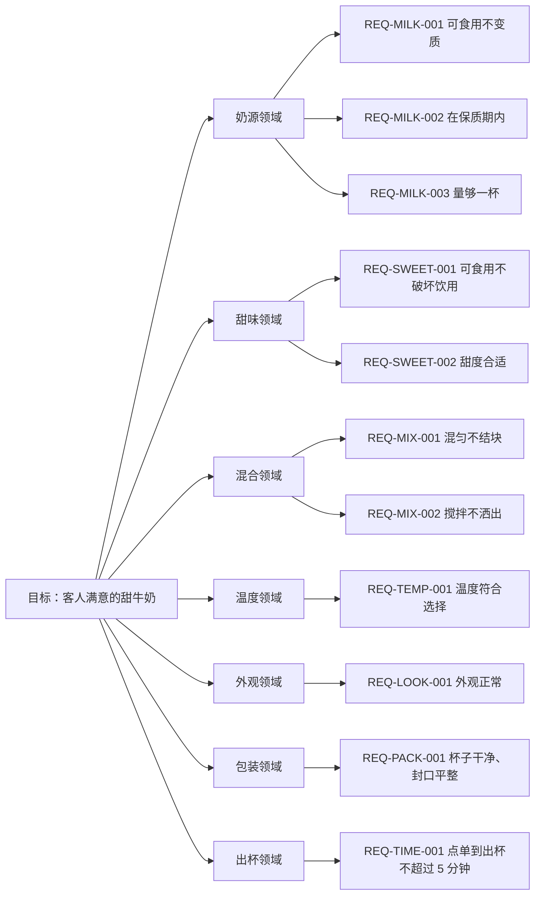

# 目标树（示例：一杯客人满意的甜牛奶）

> 这是示例，不是本项目的需求。它按 DDD 原文的顺序组织：定义问题 → 场景分析 → 划子域 → 事件风暴 → 命令风暴 → 识别模型 → 识别上下文 → 通用语言 → 模型落地。

## 一、定义目标

> 做出一杯客人满意的甜牛奶。

## 二、目标分析

我们的目标是要做出一杯让客人满意的甜牛奶。但是我们可以发现，这一句话当中的概念过于抽象，无法直接执行。在研究如何做出一杯让客户满意的甜牛奶之前，我们要先把概念定义清楚。

### 客人是谁

客人是点这杯、并且为它付钱的人。不付钱的同伴不算客人，验收以付钱的人为准。请客时，付钱的人指定谁喝，被指定的人算客人。

### 满意指什么

1. 客人尝过，说甜度可以接受；
2. 要冰的、常温的、热的，端上来就是那个温度；
3. 没有结块，没有异味；
4. 包装看着漂亮；
5. 等待时间不过长；
6. 客人当场没有要求重做。

“包装漂亮”和“等待时间不过长”还比较含糊，后面用 REQ 和 AC 变成能检查的标准。

### 甜的标准

甜味来自白糖、蜂蜜或炼乳，三选一。代糖不算；要做无糖版本，另开一条规则。糖量一到两勺，三勺就过甜了。

### 牛奶指什么

牛奶指鲜牛奶，或者全脂奶粉按比例冲兑。豆奶、燕麦奶、椰奶都不算。乳糖不耐受的替换，这一轮先不考虑。

## 三、场景分析

场景不是一个时间线，而是一个像鱼骨一样的分支。每个场景都要写出成功、失败、异常。

```
点单
  成功：客人点了甜牛奶 → 订单创建
  失败：售罄或材料不足 → 告知客人，不接单
  异常：客人中途改单 → 以最后确认为准

取奶
  成功：拿到合格牛奶 → 奶倒进杯子
  失败：奶变质或过期 → 换一批；没有可用的 → 告知客人

加甜
  成功：甜味加入 → 甜度到位
  失败：糖量超过两勺 → 判为过甜，重做

混合
  成功：搅匀 → 没有结块
  失败：结块或分层 → 重新搅拌，仍不行则重做

调温
  成功：温度符合客人选择
  失败：温度不对 → 调整后再交付

装杯
  成功：杯子干净、封口平整
  失败：杯脏或封口渗漏 → 换杯

交付
  成功：按时交付 → 客人拿到
  失败：超过 5 分钟 → 记录超时，说明原因

品尝
  成功：客人认可 → 结束
  异常：客人要求重做 → 回到加甜或混合
```

## 四、划子域

对场景分类：哪些场景重要、哪些是支撑、哪些通用。按“谁负责保证哪条结果”归并，得到子域。

| 场景 | 归到子域 |
| --- | --- |
| 取奶 | 奶源 |
| 加甜 | 甜味 |
| 混合 | 混合 |
| 调温 | 温度 |
| 端上桌的样子 | 外观 |
| 装杯 | 包装 |
| 点单、交付 | 出杯 |

七个子域：奶源、甜味、混合、温度、外观、包装、出杯。

## 五、事件风暴

在子域里列出发生了什么，用过去式。

| 事件 | 属于子域 |
| --- | --- |
| 订单创建 | 出杯 |
| 牛奶取出 | 奶源 |
| 牛奶倒入杯中 | 奶源 |
| 甜味加入 | 甜味 |
| 甜度判定完成 | 甜味 |
| 混合完成 | 混合 |
| 温度达标 | 温度 |
| 装杯完成 | 包装 |
| 交付完成 | 出杯 |
| 客人认可 | 出杯 |
| 客人要求重做 | 出杯 |

## 六、命令风暴

每个事件由谁发起、要什么输入、谁不能做。

| 命令 | 发起者 | 输入 | 谁不能做 |
| --- | --- | --- | --- |
| 点单 | 客人 | 甜度、温度、数量 | 售罄时不能下单 |
| 取奶 | 店员 | 牛奶批次 | 奶过期时不能取用 |
| 加甜 | 店员 | 糖的种类、勺数 | 超过两勺不能加 |
| 搅拌 | 店员 | 工具、时长 | 杯未装好时不能搅 |
| 调温 | 店员 | 目标温度 | 未封杯前不能交付 |
| 封杯 | 店员 | 杯子、封膜 | 杯口有污渍不能封 |
| 交付 | 店员 | 订单号 | 超时未完成不能交付 |

## 七、识别模型

| 名词 | 类型 | 说明 |
| --- | --- | --- |
| 订单 | 实体 | 一次点单，有编号和状态 |
| 饮品 | 实体 | 一杯具体的甜牛奶，属于某个订单 |
| 牛奶批次 | 实体 | 一盒鲜奶或一罐奶粉，有保质期 |
| 甜度 | 值对象 | 由糖的种类和勺数决定 |
| 温度 | 值对象 | 由档位（冰、常温、热）决定 |

聚合：

| 聚合 | 聚合根 | 保证什么一致 |
| --- | --- | --- |
| 订单 + 饮品 | 订单 | 一个订单下的饮品数量、甜度、温度必须一致 |
| 牛奶批次 | 牛奶批次 | 批次过期后不能再取用 |

## 八、识别上下文

拿模型清单回头校正子域边界：

```
奶源    只负责牛奶批次与取用，不碰甜度
甜味    只负责糖的种类与勺数，不碰温度
混合    只负责搅匀，不碰包装
温度    只负责档位与达标，不碰交付
外观    只负责端上桌的状态，不碰封口
包装    只负责杯子与封口，不碰内容物
出杯    只负责点单、排队、交付时间，不碰制作
```

边界不重叠，每个事件恰好属于一个子域。

## 九、通用语言

| 术语 | 定义 | 属于 |
| --- | --- | --- |
| 客人 | 点单并为这杯付钱的人 | 出杯 |
| 订单 | 一次点单的记录 | 出杯 |
| 饮品 | 一杯具体的甜牛奶 | 出杯 |
| 甜度 | 糖的种类与勺数 | 甜味 |
| 温度 | 冰、常温、热三档 | 温度 |
| 出杯 | 从点单到交付的这段过程 | 出杯 |

## 十、金字塔（图）



## 十一、文字金字塔

```
- **目标**：做出一杯客人满意的甜牛奶
  - **奶源领域**（解决：奶从哪来、够不够、新不新鲜）
    - **REQ-MILK-001 必要条件：牛奶必须可食用、没有变质**
      - AC：Given 一盒鲜奶 When 闻气味、看状态 Then 没有异味、没有絮状物
        - 用例：取 200 毫升鲜奶，闻气味、看状态 → 通过
      - AC：Given 两勺奶粉兑 200 毫升水 When 搅匀 Then 没有结块
        - 用例：取两勺奶粉兑 200 毫升水，搅匀后看状态 → 通过
    - **REQ-MILK-002 必要条件：牛奶必须在保质期内**
      - AC：Given 一盒鲜奶 When 查看包装日期 Then 在标注日期内
        - 用例：查看包装日期，取未过期的 → 通过
      - AC：Given 一罐奶粉 When 查看开封日期 Then 在一周内
        - 用例：查看开封日期，取一周内的 → 通过
    - **REQ-MILK-003 必要条件：量至少够做一杯**
      - AC：Given 一个量杯 When 倒入鲜奶 Then 至少 200 毫升
        - 用例：量杯量取 200 毫升 → 通过
  - **甜味领域**（解决：甜不甜、甜得合不合适）
    - **REQ-SWEET-001 必要条件：甜味来源必须可食用，且不破坏能不能喝**
      - AC：Given 一杯牛奶 When 加一勺白糖 Then 仍然能喝
        - 用例：加一勺白糖搅匀，尝一口 → 通过
      - AC：Given 一杯牛奶 When 加一勺蜂蜜 Then 仍然能喝
        - 用例：加一勺蜂蜜搅匀，尝一口 → 通过
      - AC：Given 一杯牛奶 When 加一勺炼乳 Then 仍然能喝
        - 用例：加一勺炼乳搅匀，尝一口 → 通过
    - **REQ-SWEET-002 必要条件：甜度要合适，客人喝着舒服**
      - AC：Given 200 毫升牛奶 When 加一勺糖 Then 客人说甜度合适
        - 用例：一勺，请客人尝 → 通过
      - AC：Given 200 毫升牛奶 When 加三勺糖 Then 客人说太甜
        - 用例：三勺，请客人尝 → 失败（判为过甜）
  - **混合领域**（解决：匀不匀、洒不洒）
    - **REQ-MIX-001 必要条件：必须混匀，不能有结块或分层**
      - AC：Given 牛奶和糖 When 用打蛋器搅 10 秒 Then 没有结块
        - 用例：打蛋器搅拌 10 秒，静置看状态 → 通过
      - AC：Given 牛奶和糖 When 用筷子搅 30 秒 Then 没有结块
        - 用例：筷子搅拌 30 秒，静置看状态 → 通过
      - AC：Given 牛奶和糖 When 盖盖摇晃 15 秒 Then 没有结块
        - 用例：盖盖摇晃 15 秒，静置看状态 → 通过
    - **REQ-MIX-002 必要条件：搅拌时不能洒出来**
      - AC：Given 倒到八分满 When 搅拌 Then 不溢出
        - 用例：倒到八分满再搅 → 通过
  - **温度领域**（解决：凉的热的、合不合客人口味）
    - **REQ-TEMP-001 必要条件：温度要符合客人的选择**
      - AC：Given 两块冰 When 测温度 Then 是凉的
        - 用例：加两块冰，测温度 → 通过
      - AC：Given 室温放置 When 测温度 Then 不凉
        - 用例：室温放置，测温度 → 通过
      - AC：Given 加热到 50 度 When 测温度 Then 是温的
        - 用例：加热到 50 度，测温度 → 通过
  - **外观领域**（解决：端上桌好不好看）
    - **REQ-LOOK-001 必要条件：端上桌时外观正常**
      - AC：Given 做好的牛奶 When 看表面 Then 没有结块
        - 用例：端上桌前看表面 → 通过
      - AC：Given 做好五分钟 When 再看 Then 不分层
        - 用例：放五分钟再看 → 通过
  - **包装领域**（解决：杯子干不干净、封没封好）
    - **REQ-PACK-001 必要条件：杯子和封口必须干净、平整**
      - AC：Given 一只空杯 When 检查杯身和杯口 Then 没有污渍、没有缺口
        - 用例：用前检查杯身、杯口 → 通过
      - AC：Given 装好的一杯 When 检查封口 Then 封膜平整、不歪、不渗
        - 用例：封口后按压检查 → 通过
  - **出杯领域**（解决：等多久、先来后到）
    - **REQ-TIME-001 必要条件：点单到交付不超过 5 分钟**
      - AC：Given 一位客人点单 When 计时到交付 Then 不超过 5 分钟
        - 用例：从点单开始计时，交付时停表 → 通过
      - AC：Given 同时三位客人点单 When 按顺序交付 Then 先到先得
        - 用例：三人同时点单，记录交付顺序 → 通过
  - **充分路径**：每条 REQ 取一条 AC，得到一条完整路径
    - 路径 A：鲜牛奶 + 白糖 + 筷子 + 常温 + 干净杯 → 客人满意的甜牛奶
    - 路径 B：奶粉冲兑 + 蜂蜜 + 打蛋器 + 冰 + 封口平整 → 客人满意的甜牛奶
    - 路径 C：鲜牛奶 + 炼乳 + 摇晃 + 加热 + 五分钟内交付 → 客人满意的甜牛奶
  - **验收**：客人尝过，说甜度合适、温度对、没有结块、包装没问题、没等太久
```
