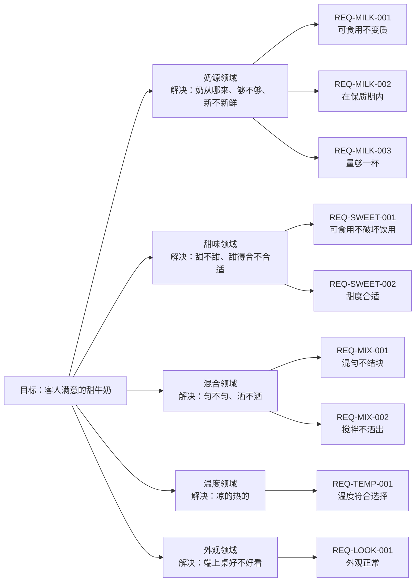

# 目标树（示例：一杯客人满意的甜牛奶）

> 这是示例，不是本项目的需求。它演示 GOAL 的五级结构：目标 → 领域（解决一组问题）→ REQ（一个必要条件）→ AC（具体要求）→ 用例（具体测法）。

## 一、目标

> 做出一杯客人满意的甜牛奶。

## 二、目标分析

我们的目标是要做出一杯让客人满意的甜牛奶。但是我们可以发现，这一句话当中的概念过于抽象，无法直接执行。在研究如何做出一杯让客户满意的甜牛奶之前，我们要先把概念定义清楚。

### 客人是谁

客人是点这杯、并且为它付钱的人。不付钱的同伴不算客人，验收以付钱的人为准。请客时，付钱的人指定谁喝，被指定的人算客人。

### 满意指什么

满意不能只凭感觉，拆成几条能检查的：

1. 客人尝过，说甜度可以接受；
2. 要冰的、常温的、热的，端上来就是那个温度；
3. 没有结块，没有异味；
4. 客人当场没有要求重做。

四条都成立，这杯才算让客人满意。

### 甜的标准

甜味来自白糖、蜂蜜或炼乳，三选一。代糖不算——要做无糖版本，另开一条规则。糖量一到两勺，三勺就过甜了。

### 牛奶指什么

牛奶指鲜牛奶，或者全脂奶粉按比例冲兑。豆奶、燕麦奶、椰奶都不算。乳糖不耐受的替换，这一轮先不考虑。

### 这一轮先不管

- 无糖和代糖版本；
- 过敏原标注；
- 同时来好几位客人时的排队顺序。

先把这些定下来，再往下拆领域和规则。

## 三、金字塔（图）



AC 与用例在下面的文字版里展开。

## 四、文字金字塔

```
- **目标**：做出一杯客人满意的甜牛奶
  - **奶源领域**（解决：奶从哪来、够不够、新不新鲜）
    - **REQ-MILK-001 必要条件：牛奶必须可食用、没有变质**
      - AC：Given 一盒鲜奶 When 闻气味、看状态 Then 没有异味、没有絮状物
        - 用例：取 200 毫升鲜奶，闻气味、看状态 → 通过
      - AC：Given 两勺奶粉兑 200 毫升水 When 搅匀 Then 没有结块
        - 用例：取两勺奶粉兑 200 毫升水，搅匀后看状态 → 通过
    - **REQ-MILK-002 必要条件：牛奶必须在保质期内**
      - AC：Given 一盒鲜奶 When 查看包装日期 Then 在标注日期内
        - 用例：查看包装日期，取未过期的 → 通过
      - AC：Given 一罐奶粉 When 查看开封日期 Then 在一周内
        - 用例：查看开封日期，取一周内的 → 通过
    - **REQ-MILK-003 必要条件：量至少够做一杯**
      - AC：Given 一个量杯 When 倒入鲜奶 Then 至少 200 毫升
        - 用例：量杯量取 200 毫升 → 通过
  - **甜味领域**（解决：甜不甜、甜得合不合适）
    - **REQ-SWEET-001 必要条件：甜味来源必须可食用，且不破坏能不能喝**
      - AC：Given 一杯牛奶 When 加一勺白糖 Then 仍然能喝
        - 用例：加一勺白糖搅匀，尝一口 → 通过
      - AC：Given 一杯牛奶 When 加一勺蜂蜜 Then 仍然能喝
        - 用例：加一勺蜂蜜搅匀，尝一口 → 通过
      - AC：Given 一杯牛奶 When 加一勺炼乳 Then 仍然能喝
        - 用例：加一勺炼乳搅匀，尝一口 → 通过
    - **REQ-SWEET-002 必要条件：甜度要合适，客人喝着舒服**
      - AC：Given 200 毫升牛奶 When 加一勺糖 Then 客人说甜度合适
        - 用例：一勺，请客人尝 → 通过
      - AC：Given 200 毫升牛奶 When 加三勺糖 Then 客人说太甜
        - 用例：三勺，请客人尝 → 失败（判为过甜）
  - **混合领域**（解决：匀不匀、洒不洒）
    - **REQ-MIX-001 必要条件：必须混匀，不能有结块或分层**
      - AC：Given 牛奶和糖 When 用打蛋器搅 10 秒 Then 没有结块
        - 用例：打蛋器搅拌 10 秒，静置看状态 → 通过
      - AC：Given 牛奶和糖 When 用筷子搅 30 秒 Then 没有结块
        - 用例：筷子搅拌 30 秒，静置看状态 → 通过
      - AC：Given 牛奶和糖 When 盖盖摇晃 15 秒 Then 没有结块
        - 用例：盖盖摇晃 15 秒，静置看状态 → 通过
    - **REQ-MIX-002 必要条件：搅拌时不能洒出来**
      - AC：Given 倒到八分满 When 搅拌 Then 不溢出
        - 用例：倒到八分满再搅 → 通过
  - **温度领域**（解决：凉的热的、合不合客人口味）
    - **REQ-TEMP-001 必要条件：温度要符合客人的选择**
      - AC：Given 两块冰 When 测温度 Then 是凉的
        - 用例：加两块冰，测温度 → 通过
      - AC：Given 室温放置 When 测温度 Then 不凉
        - 用例：室温放置，测温度 → 通过
      - AC：Given 加热到 50 度 When 测温度 Then 是温的
        - 用例：加热到 50 度，测温度 → 通过
  - **外观领域**（解决：端上桌好不好看）
    - **REQ-LOOK-001 必要条件：端上桌时外观正常**
      - AC：Given 做好的牛奶 When 看表面 Then 没有结块
        - 用例：端上桌前看表面 → 通过
      - AC：Given 做好五分钟 When 再看 Then 不分层
        - 用例：放五分钟再看 → 通过
  - **充分路径**：每条 REQ 取一条 AC，得到一条完整路径
    - 路径 A：鲜牛奶 + 白糖 + 筷子 + 常温 → 客人满意的甜牛奶
    - 路径 B：奶粉冲兑 + 蜂蜜 + 打蛋器 + 冰 → 客人满意的甜牛奶
    - 路径 C：鲜牛奶 + 炼乳 + 摇晃 + 加热 → 客人满意的甜牛奶
  - **验收**：客人尝过，说甜度合适、温度对、没有结块
```
