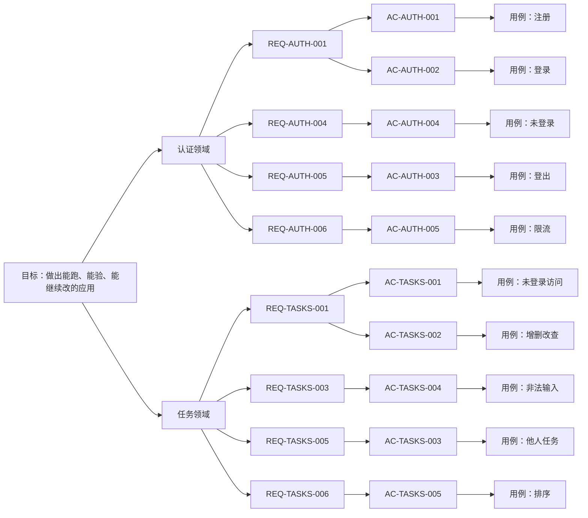

# 目标树（需求真源）

一份文档说清要什么、做到哪。开头是说明与图，中间是建模过程，下面是逐级的文字金字塔。

## 一、这份文档是什么

整套文档的唯一入口，也是人和 Agent 之间的接口。

**它管什么**：目标是什么、由哪几个领域承担、每个领域必须成立哪些规则、每条规则怎么验收。
不管系统长什么样（那是 [设计事实](designs/)），也不管怎么写（那是 [工程标准](standards/)）。

**五级结构**：

```
第 1 级  目标        这套软件最终让人完成什么
第 2 级  领域        一块业务边界：一套词、一套规则、一个边界
第 3 级  REQ         这个边界里必须成立的规则
第 4 级  AC          用户做什么、看到什么
第 5 级  测试用例    怎么证明这条 AC 成立（结果 + 证据）
```

**人怎么用**：只改目标、领域、REQ、AC；改完跑 `pnpm goal:audit --record "结论"`。
**Agent 怎么用**：每轮从这里读起，把结果和证据写回每条 AC 下面的用例行。

**为什么要有它**：Agent 做长任务会偏移。这份文档把目标、规则、验收、证据串成一条线，
让它每一轮都能回到“要什么、做到哪”。代价是它不拦人：偏移会留下痕迹，但不阻止偏移。

**状态含义**：

| 状态 | 意思 |
| --- | --- |
| 缺测试 | 没有测试文件提到这条 AC |
| 测试缺编号 | 有文件，但测试标题没有 `[AC-编号]` |
| 有测试 | 有测试，还没跑或没证据 |
| 已验证 | 测试通过，或浏览器类 AC 已有截图 |
| 缺证据 | 有测试，但没有运行日志或截图 |
| 缺截图 | 浏览器类 AC 只有日志 |
| 失败 | 最近一次运行失败 |

## 二、金字塔（图）



> 外壳是非领域，只承担路由与布局，不进入金字塔；它的设计见 [designs](designs/)。

## 三、建模过程

这一节按顺序记录怎么想出来的：事件 → 命令 → 模型 → 上下文 → 语言 → 结构 → 回审。

### 1. 事件风暴

用户做了什么、系统发生了什么。用过去式，只写会改变系统状态的事。

| 事件 | 属于 | 说明 |
| --- | --- | --- |
| 注册成功 | 认证 | 新账号建立，并直接进入工作台 |
| 登录成功 | 认证 | 凭证正确，会话建立 |
| 会话建立 | 认证 | 后续请求都靠它识别身份 |
| 登出成功 | 认证 | 会话失效 |
| 访问被拒 | 认证 | 没会话或会话失效，被带回登录页 |
| 任务创建 | 任务 | 新任务落到当前用户名下 |
| 任务更新 | 任务 | 标题或状态变化 |
| 任务完成 | 任务 | 状态变为完成 |
| 任务删除 | 任务 | 从列表消失 |
| 越权访问被拒 | 任务 | 打开他人任务，按不存在处理 |

### 2. 命令风暴

每个事件由谁发起、要什么输入、谁不能做。

| 命令 | 发起者 | 输入 | 谁不能做 |
| --- | --- | --- | --- |
| 提交注册 | 未登录用户 | 用户名、邮箱、密码 | 已登录用户、邮箱已被占用 |
| 提交登录 | 未登录用户 | 邮箱、密码 | 已登录用户、凭证错误 |
| 点击登出 | 已登录用户 | 无 | 未登录用户 |
| 打开受保护页面 | 任意访问者 | 页面地址 | 没有有效会话的人 |
| 创建任务 | 已登录用户 | 标题 | 未登录用户、标题为空或超长 |
| 编辑任务 | 任务所有者 | 任务 ID、标题 | 非所有者、标题为空或超长 |
| 完成任务 | 任务所有者 | 任务 ID | 非所有者 |
| 删除任务 | 任务所有者 | 任务 ID | 非所有者 |
| 获取任务列表 | 已登录用户 | 无 | 未登录用户 |

### 3. 识别模型

哪些名词承载状态与规则。

| 名词 | 类型 | 说明 |
| --- | --- | --- |
| 用户 | 实体 | 有账号、有生命周期，删除后其数据一并失效 |
| 会话 | 实体 | 一次登录的凭证，必须属于一个存在的用户 |
| 任务 | 实体 | 一条待办，有标题、状态、归属 |
| 邮箱 | 值对象 | 只由值决定，改了就是新值 |
| 密码哈希 | 值对象 | 只由值决定，不单独追踪 |
| 标题 | 值对象 | 只由值决定，改了就是新值 |

聚合：

| 聚合 | 聚合根 | 保证什么一致 |
| --- | --- | --- |
| 用户 + 会话 | 用户 | 会话必须属于存在的用户；删除用户时会话一起失效 |
| 任务 | 任务 | 任务必须属于一个用户；删除用户时任务一并失效 |

### 4. 识别上下文

同样的词在两处含义不同就切开，同一条事件链就合并。

| 领域 | 依据 | 边界 |
| --- | --- | --- |
| 认证领域 | 注册、登录、会话、登出是同一条事件链 | 管身份与会话；不管权限分级、团队成员、找回密码 |
| 任务领域 | 任务有自己的实体与生命周期，和身份是两套规则 | 管归属、校验、排序；不管标签、提醒、统计 |
| 外壳（非领域） | 没有自己的业务事件，只做路由与布局 | 不含业务规则 |

为什么是这两块，不是更多：团队、通知、文件、统计、计费都想过，当前目标用不上，写进“不覆盖”。

### 5. 通用语言

| 编号 | 术语 | 定义 | 属于 |
| --- | --- | --- | --- |
| TERM-USER | 用户 | 有账号的人，数据归属的唯一依据 | 认证 |
| TERM-SESSION | 会话 | 一次登录的凭证 | 认证 |
| TERM-TASK | 任务 | 用户创建的一条待办，有标题、状态、归属 | 任务 |
| TERM-OWNER | 所有者 | 任务所属的账号 | 任务 |

同一个词不在两处用两个意思：任务领域里的“用户”一律写“所有者”。

### 6. 结构与规则

下面是金字塔的文字版：目标 → 领域 → REQ → AC → 测试用例。

<!-- goal-summary -->
合计 10 条：已验证 10
<!-- /goal-summary -->

- **目标**：让一个人从一个想法开始，直接用一套能跑、能验、能继续改的代码做出自己的应用。

  - **认证领域**（支撑子域）
    - 事件链：注册 → 登录 → 会话 → 登出
    - 聚合：用户、会话（会话必须属于一个存在的用户；删除用户时会话一起失效）
    - 边界：管身份与会话；不管权限分级、团队成员、找回密码
    - 为什么这样切：账号与会话是同一条事件链、生命周期一致，合并为一个领域；权限分级没有多角色需求，砍掉
    - 术语：用户 = 有账号的人；会话 = 一次登录的凭证
    - **REQ-AUTH-001 注册和登录使用邮箱与密码**
      - 来源事件：注册、登录
      - 规则：邮箱密码合法才建立会话，否则拒绝并提示
      - AC-AUTH-001（REQ-AUTH-001）：Given 新用户提交合法邮箱和密码 When 注册 Then 创建账户并进入 Dashboard。
        - **测试用例**：新用户首次注册 → 能进入工作台开始用 ｜ **状态**：已验证 ｜ [用例](others/test-cases/auth.md#ac-auth-001) · [tests/e2e/auth.spec.ts](../tests/e2e/auth.spec.ts) · [查看](others/evidence/AC-AUTH-001/2026-11-08.png)
      - AC-AUTH-002（REQ-AUTH-001）：Given 已注册用户提交正确凭证 When 登录 Then 建立 session 并进入 Dashboard。
        - **测试用例**：老用户登录 → 进入自己的工作台 ｜ **状态**：已验证 ｜ [用例](others/test-cases/auth.md#ac-auth-002) · [tests/e2e/auth.spec.ts](../tests/e2e/auth.spec.ts) · [查看](others/evidence/AC-AUTH-002/2026-11-08.png)
    - **REQ-AUTH-004 业务 API 只从 session 获取身份**
      - 来源事件：打开需要登录的页面、调用受保护接口
      - 规则：身份只从 session 取，不信任客户端传入的 userId；没有会话就不能读业务数据
      - AC-AUTH-004（REQ-AUTH-004、REQ-AUTH-005）：Given 没有登录 When 打开需要登录的页面 Then 被带回登录页，看不到任何业务数据
        - **测试用例**：未登录直接打开受保护页 → 被带回登录页 ｜ **状态**：已验证 ｜ [用例](others/test-cases/auth.md#ac-auth-004) · [tests/api/tasks.test.ts](../tests/api/tasks.test.ts) · [查看](others/evidence/goal-runs/2026-11-08-07-34.txt)
    - **REQ-AUTH-005 登出后不能继续访问受保护页面**
      - 来源事件：登出
      - 规则：登出后旧会话失效，受保护页面与接口都不可再访问
      - AC-AUTH-003（REQ-AUTH-005）：Given 用户登出 When 再次访问 `/dashboard` Then 跳转首页。
        - **测试用例**：用户登出后按后退键 → 仍停在首页 ｜ **状态**：已验证 ｜ [用例](others/test-cases/auth.md#ac-auth-003) · [tests/e2e/auth.spec.ts](../tests/e2e/auth.spec.ts) · [查看](others/evidence/AC-AUTH-003/2026-11-08.png)
    - **REQ-AUTH-006 生产环境开启认证限流**
      - 来源事件：登录
      - 规则：只有真实生产环境启用认证限流，开发与测试环境关闭；生产构建方式下的隔离 E2E 仍可重复执行
      - AC-AUTH-005（REQ-AUTH-006）：Given 开发、测试或生产环境 When 初始化认证服务 Then 只有真实生产环境启用认证限流，生产构建方式下的隔离 E2E 仍可重复执行。
        - **测试用例**：生产环境反复登录 → 认证流程正常且可重复 ｜ **状态**：已验证 ｜ [用例](others/test-cases/auth.md#ac-auth-005) · [tests/e2e/auth.spec.ts](../tests/e2e/auth.spec.ts) · [查看](others/evidence/AC-AUTH-005/2026-11-08.png)
  - **任务领域**（支撑子域）
    - 事件链：创建 → 查看 → 编辑 → 完成 → 删除
    - 聚合：任务（任务必须属于一个用户；删除用户时任务一并失效）
    - 边界：管归属、校验、排序；不管标签、提醒、统计
    - 为什么这样切：任务有自己的实体与生命周期，和身份是两套规则，硬合并会让归属校验和会话校验互相污染
    - 术语：任务 = 一条待办，有标题、状态、归属；所有者 = 任务所属的账号
    - **REQ-TASKS-001 用户只能读取自己的任务**
      - 来源事件：打开任务页、创建任务
      - 规则：未登录不能访问任务页；任务只属于创建它的用户
      - AC-TASKS-001（REQ-TASKS-001）：Given 未登录用户 When 访问任务页面 Then 应跳转到首页。
        - **测试用例**：未登录访问工作台 → 被带回首页 ｜ **状态**：已验证 ｜ [用例](others/test-cases/tasks.md#ac-tasks-001) · [tests/e2e/auth.spec.ts](../tests/e2e/auth.spec.ts) · [查看](others/evidence/AC-TASKS-001/2026-11-08.png)
      - AC-TASKS-002（REQ-TASKS-001、REQ-TASKS-002）：Given 已登录用户 When 创建任务 Then 任务只属于当前用户并出现在列表中。
        - **测试用例**：登录用户增删改查任务 → 列表立即反映结果 ｜ **状态**：已验证 ｜ [用例](others/test-cases/tasks.md#ac-tasks-002) · [tests/e2e/tasks.spec.ts](../tests/e2e/tasks.spec.ts) · [查看](others/evidence/AC-TASKS-002/2026-11-08.png)
    - **REQ-TASKS-005 更新或删除非本人任务返回 404**
      - 来源事件：打开他人任务链接、调用他人任务接口
      - 规则：非本人任务一律按不存在处理，不泄露它是否存在
      - AC-TASKS-003（REQ-TASKS-001、REQ-TASKS-005）：Given 用户打开别人的任务链接 When 页面加载 Then 显示“任务不存在”而不是任务内容
        - **测试用例**：用户打开别人的任务链接 → 显示任务不存在 ｜ **状态**：已验证 ｜ [用例](others/test-cases/tasks.md#ac-tasks-003) · [tests/api/tasks.test.ts](../tests/api/tasks.test.ts) · [查看](others/evidence/goal-runs/2026-11-08-07-34.txt)
    - **REQ-TASKS-003 标题非空且不超过 200 字符**
      - 来源事件：提交任务表单、编辑任务
      - 规则：标题为空或超过 200 字符时拒绝保存，并提示用户
      - AC-TASKS-004（REQ-TASKS-003、REQ-TASKS-004）：Given 用户提交空标题或超长标题 When 保存 Then 表单提示错误，任务不保存
        - **测试用例**：用户提交空标题或超长标题 → 表单提示错误且不保存 ｜ **状态**：已验证 ｜ [用例](others/test-cases/tasks.md#ac-tasks-004) · [tests/api/tasks.test.ts](../tests/api/tasks.test.ts) · [查看](others/evidence/goal-runs/2026-11-08-07-34.txt)
    - **REQ-TASKS-006 列表按 createdAt 倒序**
      - 来源事件：获取任务列表
      - 规则：列表按创建时间倒序返回，最新创建的排在最前
      - AC-TASKS-005（REQ-TASKS-006）：Given 当前用户有多条任务 When 获取列表 Then 任务按 `createdAt` 倒序返回。
        - **测试用例**：用户有多条任务 → 最新任务排在最前 ｜ **状态**：已验证 ｜ [用例](others/test-cases/tasks.md#ac-tasks-005) · [tests/api/tasks.test.ts](../tests/api/tasks.test.ts) · [查看](others/evidence/goal-runs/2026-11-08-07-34.txt)
  - **外壳（非领域）**

### 7. 回审

| 检查 | 结果 |
| --- | --- |
| 事件是否都有归属 | 是，10 条事件分属两个领域 |
| 领域边界是否互斥 | 是，认证管身份、任务管归属 |
| 术语是否一词一义 | 是，用户只属于认证，任务里写所有者 |
| 结构检查 | `pnpm goal:audit` 通过 |
| 追溯检查 | `pnpm goal:trace` 通过 |

**当前不覆盖**：团队/多租户、消息通知、文件上传、审计日志、找回密码、标签与提醒。

**已知缺口**：注册重复邮箱的提示、密码重置、多用户并发写同一条任务，都还没定。

**关系**：任务依赖认证（任务归属用户）；外壳组合认证与任务。

**完成判定**：验收标准见 [测试标准](standards/testing.md)；金字塔只声明要什么，不规定怎么验。
