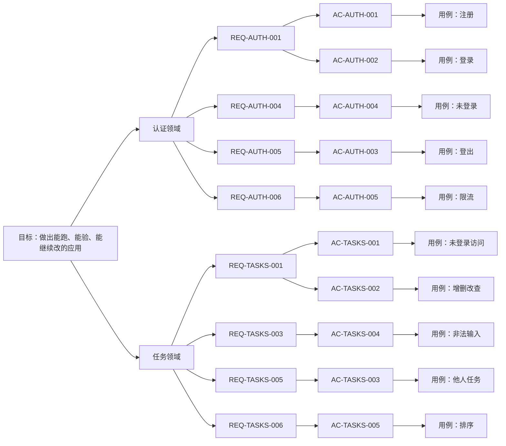
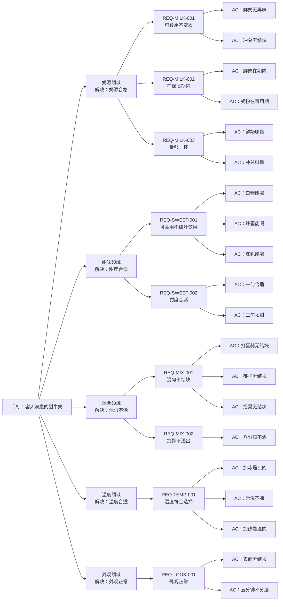

# 目标树（需求真源）

一份文档说清要什么、做到哪。开头是说明与图，中间讲必要条件与充分路径，下面是逐级的文字金字塔。

> **不知道怎么写？** 先读 [GOAL 规格](standards/goal-spec.md)：写什么、按什么顺序想、每层必须写清什么。

## 一、这份文档是什么

整套文档的唯一入口，也是人和 Agent 之间的接口。

**它管什么**：目标是什么、由哪几个领域承担、每个领域必须成立哪些规则、每条规则怎么验收。
不管系统长什么样（那是 [设计事实](designs/)），也不管怎么写（那是 [工程标准](standards/)）。

**五级结构**：

```
第 1 级  目标        这套软件最终让人完成什么
第 2 级  领域        一块业务边界：一套词、一套规则、一个边界
第 3 级  REQ         这个边界里必须成立的规则
第 4 级  AC          用户做什么、看到什么
第 5 级  测试用例    怎么证明这条 AC 成立（结果 + 证据）
```

**人怎么用**：只改目标、领域、REQ、AC；改完跑 `pnpm goal:audit --record "结论"`。
**Agent 怎么用**：每轮从这里读起，把结果和证据写回每条 AC 下面的用例行。

**为什么要有它**：Agent 做长任务会偏移。这份文档把目标、规则、验收、证据串成一条线，
让它每一轮都能回到“要什么、做到哪”。代价是它不拦人：偏移会留下痕迹，但不阻止偏移。

**状态含义**：

| 状态 | 意思 |
| --- | --- |
| 缺测试 | 没有测试文件提到这条 AC |
| 测试缺编号 | 有文件，但测试标题没有 `[AC-编号]` |
| 有测试 | 有测试，还没跑或没证据 |
| 已验证 | 测试通过，或浏览器类 AC 已有截图 |
| 缺证据 | 有测试，但没有运行日志或截图 |
| 缺截图 | 浏览器类 AC 只有日志 |
| 失败 | 最近一次运行失败 |


**术语表**：

| 编号 | 术语 | 定义 | 属于 |
| --- | --- | --- | --- |
| TERM-USER | 用户 | 有账号的人，数据归属的唯一依据 | 认证 |
| TERM-SESSION | 会话 | 一次登录的凭证 | 认证 |
| TERM-TASK | 任务 | 用户创建的一条待办，有标题、状态、归属 | 任务 |
| TERM-OWNER | 所有者 | 任务所属的账号 | 任务 |

## 二、金字塔（图）



> 外壳是非领域，只承担路由与布局，不进入金字塔；它的设计见 [designs](designs/)。

## 三、必要条件与充分路径

金字塔往下走，每一层都是上一层的**必要条件**；而同一层里可以有多条**充分路径**。

```
必要条件   缺一条就不成立，像漏斗，先筛掉不可能的
充分路径   条件满足后，能走通的一条完整路线，像路线图
```

所以金字塔不是一条直线：上一层是一个目标，下一层是达成它必须满足的几件事；每件事再往下，又分出多条可能的走法。

### 牛奶的例子（完整版）

层次和规格一致：目标 → 领域（解决一组问题）→ REQ（一个必要条件，也就是规则）→ AC（一个具体要求，写成 Given/When/Then）→ 用例（具体测法）。

```
目标：做出一杯客人满意的甜牛奶

领域：奶源（解决：奶从哪来、够不够、新不新鲜）
  REQ-MILK-001 必要条件：牛奶必须可食用、没有变质
    AC：Given 一盒鲜奶 When 闻气味、看状态 Then 没有异味、没有絮状物
      用例：取 200 毫升鲜奶，闻气味、看状态 → 通过
    AC：Given 两勺奶粉兑 200 毫升水 When 搅匀 Then 没有结块
      用例：取两勺奶粉兑 200 毫升水，搅匀后看状态 → 通过
  REQ-MILK-002 必要条件：牛奶必须在保质期内
    AC：Given 一盒鲜奶 When 查看包装日期 Then 在标注日期内
      用例：查看包装日期，取未过期的 → 通过
    AC：Given 一罐奶粉 When 查看开封日期 Then 在一周内
      用例：查看开封日期，取一周内的 → 通过
  REQ-MILK-003 必要条件：量至少够做一杯
    AC：Given 一个量杯 When 倒入鲜奶 Then 至少 200 毫升
      用例：量杯量取 200 毫升 → 通过
    AC：Given 一个量杯 When 冲兑奶粉 Then 到 200 毫升刻度
      用例：奶粉冲兑到 200 毫升刻度 → 通过

领域：甜味（解决：甜不甜、甜得合不合适）
  REQ-SWEET-001 必要条件：甜味来源必须可食用，且不破坏能不能喝
    AC：Given 一杯牛奶 When 加一勺白糖 Then 仍然能喝
      用例：加一勺白糖搅匀，尝一口 → 通过
    AC：Given 一杯牛奶 When 加一勺蜂蜜 Then 仍然能喝
      用例：加一勺蜂蜜搅匀，尝一口 → 通过
    AC：Given 一杯牛奶 When 加一勺炼乳 Then 仍然能喝
      用例：加一勺炼乳搅匀，尝一口 → 通过
  REQ-SWEET-002 必要条件：甜度要合适，客人喝着舒服
    AC：Given 200 毫升牛奶 When 加一勺糖 Then 客人说甜度合适
      用例：一勺，请客人尝 → 通过
    AC：Given 200 毫升牛奶 When 加三勺糖 Then 客人说太甜
      用例：三勺，请客人尝 → 失败（判为过甜）

领域：混合（解决：匀不匀、洒不洒）
  REQ-MIX-001 必要条件：必须混匀，不能有结块或分层
    AC：Given 牛奶和糖 When 用打蛋器搅 10 秒 Then 没有结块
      用例：打蛋器搅拌 10 秒，静置看状态 → 通过
    AC：Given 牛奶和糖 When 用筷子搅 30 秒 Then 没有结块
      用例：筷子搅拌 30 秒，静置看状态 → 通过
    AC：Given 牛奶和糖 When 盖盖摇晃 15 秒 Then 没有结块
      用例：盖盖摇晃 15 秒，静置看状态 → 通过
  REQ-MIX-002 必要条件：搅拌时不能洒出来
    AC：Given 倒到八分满 When 搅拌 Then 不溢出
      用例：倒到八分满再搅 → 通过

领域：温度（解决：凉的热的、合不合客人口味）
  REQ-TEMP-001 必要条件：温度要符合客人的选择
    AC：Given 两块冰 When 测温度 Then 是凉的
      用例：加两块冰，测温度 → 通过
    AC：Given 室温放置 When 测温度 Then 不凉
      用例：室温放置，测温度 → 通过
    AC：Given 加热到 50 度 When 测温度 Then 是温的
      用例：加热到 50 度，测温度 → 通过

领域：外观（解决：端上桌好不好看）
  REQ-LOOK-001 必要条件：端上桌时外观正常
    AC：Given 做好的牛奶 When 看表面 Then 没有结块
      用例：端上桌前看表面 → 通过
    AC：Given 做好五分钟 When 再看 Then 不分层
      用例：放五分钟再看 → 通过

组合成路径：
  路径 A：鲜牛奶 + 白糖 + 筷子 + 常温 → 客人满意的甜牛奶
  路径 B：奶粉冲兑 + 蜂蜜 + 打蛋器 + 冰 → 客人满意的甜牛奶
  路径 C：鲜牛奶 + 炼乳 + 摇晃 + 加热 → 客人满意的甜牛奶
验收：客人尝过，说甜度合适、温度对、没有结块
```

换成金字塔：

```
- **目标**：做出一杯客人满意的甜牛奶
  - **奶源领域**（解决：奶从哪来、够不够、新不新鲜）
    - **REQ-MILK-001 必要条件：牛奶必须可食用、没有变质**
      - AC：Given 一盒鲜奶 When 闻气味、看状态 Then 没有异味、没有絮状物
        - 用例：取 200 毫升鲜奶，闻气味、看状态 → 通过
      - AC：Given 两勺奶粉兑 200 毫升水 When 搅匀 Then 没有结块
        - 用例：取两勺奶粉兑 200 毫升水，搅匀后看状态 → 通过
    - **REQ-MILK-002 必要条件：牛奶必须在保质期内**
      - AC：Given 一盒鲜奶 When 查看包装日期 Then 在标注日期内
        - 用例：查看包装日期，取未过期的 → 通过
      - AC：Given 一罐奶粉 When 查看开封日期 Then 在一周内
        - 用例：查看开封日期，取一周内的 → 通过
    - **REQ-MILK-003 必要条件：量至少够做一杯**
      - AC：Given 一个量杯 When 倒入鲜奶 Then 至少 200 毫升
        - 用例：量杯量取 200 毫升 → 通过
      - AC：Given 一个量杯 When 冲兑奶粉 Then 到 200 毫升刻度
        - 用例：奶粉冲兑到 200 毫升刻度 → 通过
  - **甜味领域**（解决：甜不甜、甜得合不合适）
    - **REQ-SWEET-001 必要条件：甜味来源必须可食用，且不破坏能不能喝**
      - AC：Given 一杯牛奶 When 加一勺白糖 Then 仍然能喝
        - 用例：加一勺白糖搅匀，尝一口 → 通过
      - AC：Given 一杯牛奶 When 加一勺蜂蜜 Then 仍然能喝
        - 用例：加一勺蜂蜜搅匀，尝一口 → 通过
      - AC：Given 一杯牛奶 When 加一勺炼乳 Then 仍然能喝
        - 用例：加一勺炼乳搅匀，尝一口 → 通过
    - **REQ-SWEET-002 必要条件：甜度要合适，客人喝着舒服**
      - AC：Given 200 毫升牛奶 When 加一勺糖 Then 客人说甜度合适
        - 用例：一勺，请客人尝 → 通过
      - AC：Given 200 毫升牛奶 When 加三勺糖 Then 客人说太甜
        - 用例：三勺，请客人尝 → 失败（判为过甜）
  - **混合领域**（解决：匀不匀、洒不洒）
    - **REQ-MIX-001 必要条件：必须混匀，不能有结块或分层**
      - AC：Given 牛奶和糖 When 用打蛋器搅 10 秒 Then 没有结块
        - 用例：打蛋器搅拌 10 秒，静置看状态 → 通过
      - AC：Given 牛奶和糖 When 用筷子搅 30 秒 Then 没有结块
        - 用例：筷子搅拌 30 秒，静置看状态 → 通过
      - AC：Given 牛奶和糖 When 盖盖摇晃 15 秒 Then 没有结块
        - 用例：盖盖摇晃 15 秒，静置看状态 → 通过
    - **REQ-MIX-002 必要条件：搅拌时不能洒出来**
      - AC：Given 倒到八分满 When 搅拌 Then 不溢出
        - 用例：倒到八分满再搅 → 通过
  - **温度领域**（解决：凉的热的、合不合客人口味）
    - **REQ-TEMP-001 必要条件：温度要符合客人的选择**
      - AC：Given 两块冰 When 测温度 Then 是凉的
        - 用例：加两块冰，测温度 → 通过
      - AC：Given 室温放置 When 测温度 Then 不凉
        - 用例：室温放置，测温度 → 通过
      - AC：Given 加热到 50 度 When 测温度 Then 是温的
        - 用例：加热到 50 度，测温度 → 通过
  - **外观领域**（解决：端上桌好不好看）
    - **REQ-LOOK-001 必要条件：端上桌时外观正常**
      - AC：Given 做好的牛奶 When 看表面 Then 没有结块
        - 用例：端上桌前看表面 → 通过
      - AC：Given 做好五分钟 When 再看 Then 不分层
        - 用例：放五分钟再看 → 通过
  - **组合**：每条 REQ 取一条 AC，得到一条完整路径
  - **验收**：客人尝过，说甜度合适、温度对、没有结块
```

图示（横着看）：



对应到软件：领域解决一组问题；一条 REQ 是一个必要条件，也就是规则；一条 REQ 下有多条 AC，AC 是具体要求、写成 Given/When/Then；每条 AC 下挂用例，用例是具体测法。

## 四、文字金字塔

<!-- goal-summary -->
合计 10 条：已验证 10
<!-- /goal-summary -->

- **目标**：让一个人从一个想法开始，直接用一套能跑、能验、能继续改的代码做出自己的应用。

  - **认证领域**（支撑子域）
    - 目的：让人能安全地进入并使用自己的工作台
    - 必要条件：账号存在、凭证正确、会话有效、请求未超限
    - 聚合：用户（根）与会话：会话必须属于存在的用户；用户删除，会话一起失效
    - 边界：管身份与会话；不管权限分级、团队成员、找回密码
    - 为什么这样切：注册、登录、会话、登出是同一条事件链、生命周期一致，合并；权限分级没有多角色需求，砍掉
    - 术语：用户 = 有账号的人；会话 = 一次登录的凭证
    - 路径：注册或登录成功：提交注册或登录 → 校验邮箱与密码 → 创建或找到账号 → 建立会话 → 进入工作台
      - **REQ-AUTH-001 注册和登录使用邮箱与密码**
        - 规则：邮箱密码合法才建立会话，否则拒绝并提示
        - AC-AUTH-001（REQ-AUTH-001）：Given 新用户提交合法邮箱和密码 When 注册 Then 创建账户并进入 Dashboard。
          - **测试用例**：新用户首次注册 → 能进入工作台开始用 ｜ **状态**：已验证 ｜ [用例](others/test-cases/auth.md#ac-auth-001) · [tests/e2e/auth.spec.ts](../tests/e2e/auth.spec.ts) · [查看](others/evidence/AC-AUTH-001/2026-11-08.png)
        - AC-AUTH-002（REQ-AUTH-001）：Given 已注册用户提交正确凭证 When 登录 Then 建立 session 并进入 Dashboard。
          - **测试用例**：老用户登录 → 进入自己的工作台 ｜ **状态**：已验证 ｜ [用例](others/test-cases/auth.md#ac-auth-002) · [tests/e2e/auth.spec.ts](../tests/e2e/auth.spec.ts) · [查看](others/evidence/AC-AUTH-002/2026-11-08.png)
    - 路径：注册失败：提交注册 → 邮箱已占用或密码不合规 → 提示 → 留在注册页（未覆盖，见已知缺口）
    - 路径：登录失败：提交登录 → 凭证错误 → 提示 → 留在登录页（未覆盖）
    - 路径：忘记密码：申请重置 → 验证身份 → 设置新密码（当前不覆盖）
    - 路径：登出：点击登出 → 会话失效 → 回首页
      - **REQ-AUTH-005 登出后不能继续访问受保护页面**
        - 规则：登出后旧会话失效，受保护页面与接口都不可再访问
        - AC-AUTH-003（REQ-AUTH-005）：Given 用户登出 When 再次访问 `/dashboard` Then 跳转首页。
          - **测试用例**：用户登出后按后退键 → 仍停在首页 ｜ **状态**：已验证 ｜ [用例](others/test-cases/auth.md#ac-auth-003) · [tests/e2e/auth.spec.ts](../tests/e2e/auth.spec.ts) · [查看](others/evidence/AC-AUTH-003/2026-11-08.png)
    - 路径：未登录或会话失效：访问受保护页 → 无有效会话 → 回登录页
      - **REQ-AUTH-004 业务 API 只从 session 获取身份**
        - 规则：身份只从 session 取，不信任客户端传入的 userId；没有会话就不能读业务数据
        - AC-AUTH-004（REQ-AUTH-004、REQ-AUTH-005）：Given 没有登录 When 打开需要登录的页面 Then 被带回登录页，看不到任何业务数据
          - **测试用例**：未登录直接打开受保护页 → 被带回登录页 ｜ **状态**：已验证 ｜ [用例](others/test-cases/auth.md#ac-auth-004) · [tests/api/tasks.test.ts](../tests/api/tasks.test.ts) · [查看](others/evidence/goal-runs/2026-11-08-07-34.txt)
    - 路径：生产限流：登录频繁 → 限流 → 正常拒绝或放行，且可重复执行
      - **REQ-AUTH-006 生产环境开启认证限流**
        - 规则：只有真实生产环境启用认证限流，开发与测试环境关闭；生产构建方式下的隔离 E2E 仍可重复执行
        - AC-AUTH-005（REQ-AUTH-006）：Given 开发、测试或生产环境 When 初始化认证服务 Then 只有真实生产环境启用认证限流，生产构建方式下的隔离 E2E 仍可重复执行。
          - **测试用例**：生产环境反复登录 → 认证流程正常且可重复 ｜ **状态**：已验证 ｜ [用例](others/test-cases/auth.md#ac-auth-005) · [tests/e2e/auth.spec.ts](../tests/e2e/auth.spec.ts) · [查看](others/evidence/AC-AUTH-005/2026-11-08.png)
  - **任务领域**（支撑子域）
    - 目的：让用户管理只属于自己的任务
    - 必要条件：已登录、任务属于当前用户、标题合法、列表可排序
    - 聚合：任务（根）：任务必须属于一个用户；用户删除，任务一起失效
    - 边界：管归属、校验、排序；不管标签、提醒、统计
    - 为什么这样切：任务有自己的实体与生命周期，和身份是两套规则；硬合并会让归属校验和会话校验互相污染
    - 术语：任务 = 一条待办，有标题、状态、归属；所有者 = 任务所属的账号
    - 路径：未登录访问任务页：打开任务页 → 无会话 → 回首页
      - **REQ-TASKS-001 用户只能读取自己的任务**
        - 规则：未登录不能访问任务页；任务只属于创建它的用户
        - AC-TASKS-001（REQ-TASKS-001）：Given 未登录用户 When 访问任务页面 Then 应跳转到首页。
          - **测试用例**：未登录访问工作台 → 被带回首页 ｜ **状态**：已验证 ｜ [用例](others/test-cases/tasks.md#ac-tasks-001) · [tests/e2e/auth.spec.ts](../tests/e2e/auth.spec.ts) · [查看](others/evidence/AC-TASKS-001/2026-11-08.png)
    - 路径：创建成功：提交任务 → 校验标题 → 任务创建 → 列表出现
      - **REQ-TASKS-001 用户只能读取自己的任务**
        - 规则：任务只属于创建它的用户，列表只返回自己的任务
        - AC-TASKS-002（REQ-TASKS-001、REQ-TASKS-002）：Given 已登录用户 When 创建任务 Then 任务只属于当前用户并出现在列表中。
          - **测试用例**：登录用户增删改查任务 → 列表立即反映结果 ｜ **状态**：已验证 ｜ [用例](others/test-cases/tasks.md#ac-tasks-002) · [tests/e2e/tasks.spec.ts](../tests/e2e/tasks.spec.ts) · [查看](others/evidence/AC-TASKS-002/2026-11-08.png)
    - 路径：创建失败：提交任务 → 标题为空或超长 → 提示 → 不保存
      - **REQ-TASKS-003 标题非空且不超过 200 字符**
        - 规则：标题为空或超过 200 字符时拒绝保存，并提示用户
        - AC-TASKS-004（REQ-TASKS-003、REQ-TASKS-004）：Given 用户提交空标题或超长标题 When 保存 Then 表单提示错误，任务不保存
          - **测试用例**：用户提交空标题或超长标题 → 表单提示错误且不保存 ｜ **状态**：已验证 ｜ [用例](others/test-cases/tasks.md#ac-tasks-004) · [tests/api/tasks.test.ts](../tests/api/tasks.test.ts) · [查看](others/evidence/goal-runs/2026-11-08-07-34.txt)
    - 路径：越权打开：打开他人任务 → 按不存在处理 → 提示不存在
      - **REQ-TASKS-005 更新或删除非本人任务返回 404**
        - 规则：非本人任务一律按不存在处理，不泄露它是否存在
        - AC-TASKS-003（REQ-TASKS-001、REQ-TASKS-005）：Given 用户打开别人的任务链接 When 页面加载 Then 显示“任务不存在”而不是任务内容
          - **测试用例**：用户打开别人的任务链接 → 显示任务不存在 ｜ **状态**：已验证 ｜ [用例](others/test-cases/tasks.md#ac-tasks-003) · [tests/api/tasks.test.ts](../tests/api/tasks.test.ts) · [查看](others/evidence/goal-runs/2026-11-08-07-34.txt)
    - 路径：列表：获取列表 → 按创建时间倒序返回
      - **REQ-TASKS-006 列表按 createdAt 倒序**
        - 规则：列表按创建时间倒序返回，最新创建的排在最前
        - AC-TASKS-005（REQ-TASKS-006）：Given 当前用户有多条任务 When 获取列表 Then 任务按 `createdAt` 倒序返回。
          - **测试用例**：用户有多条任务 → 最新任务排在最前 ｜ **状态**：已验证 ｜ [用例](others/test-cases/tasks.md#ac-tasks-005) · [tests/api/tasks.test.ts](../tests/api/tasks.test.ts) · [查看](others/evidence/goal-runs/2026-11-08-07-34.txt)
    - 路径：编辑、完成、删除：打开任务 → 校验归属 → 更新状态 → 列表刷新（未覆盖，见已知缺口）
    - 路径：并发写同一条任务：两个请求同时改 → 后写覆盖先写（未覆盖，见已知缺口）
  - **外壳（非领域）**

**关系**：任务依赖认证（任务归属用户）；外壳组合认证与任务。

**当前不覆盖**：团队/多租户、消息通知、文件上传、审计日志、找回密码、标签与提醒。

**已知缺口**：注册重复邮箱的提示、密码重置、多用户并发写同一条任务。

**完成判定**：验收标准见 [测试标准](standards/testing.md)；金字塔只声明要什么，不规定怎么验。
