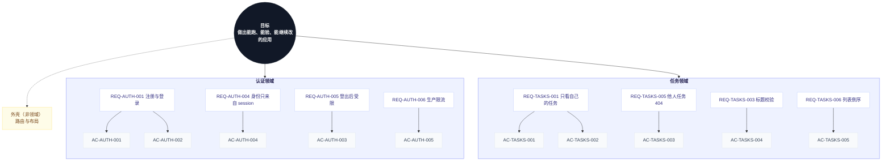

# 目标树（需求真源）

一份文档说清要什么、做到哪。开头是介绍与边界，中间是图，下面是逐级的文字金字塔。

## 一、这份文档是什么

整套文档的唯一入口，也是人和 Agent 之间的接口。

**它管什么**：目标是什么、由哪几个领域承担、每个领域必须成立哪些规则、每条规则怎么验收。
不管系统长什么样（那是 [设计事实](designs/)），也不管怎么写（那是 [工程标准](standards/)）。

**五级结构**：

```
第 1 级  目标        这套软件最终让人完成什么
第 2 级  领域        一块业务边界
第 3 级  REQ         这个边界里必须成立的规则
第 4 级  AC          用户做什么、看到什么
第 5 级  测试用例    怎么证明这条 AC 成立（结果 + 证据）
```

**人怎么用**：只改目标、领域、REQ、AC；改完跑 `pnpm goal:audit --record "结论"`。
**Agent 怎么用**：每轮从这里读起，把结果和证据写回每条 AC 下面的用例行。

**为什么要有它**：Agent 做长任务会偏移。这份文档把目标、规则、验收、证据串成一条线，
让它每一轮都能回到“要什么、做到哪”。代价是它不拦人：偏移会留下痕迹，但不阻止偏移。

**状态含义**：

| 状态       | 意思                               |
| ---------- | ---------------------------------- |
| 缺测试     | 没有测试文件提到这条 AC            |
| 测试缺编号 | 有文件，但测试标题没有 `[AC-编号]` |
| 有测试     | 有测试，还没跑或没证据             |
| 已验证     | 测试通过，或浏览器类 AC 已有截图   |
| 缺证据     | 有测试，但没有运行日志或截图       |
| 缺截图     | 浏览器类 AC 只有日志               |
| 失败       | 最近一次运行失败                   |

**术语**：

| 编号      | 术语 | 定义                             |
| --------- | ---- | -------------------------------- |
| TERM-USER | 用户 | 有账号的人，数据归属的唯一依据   |
| TERM-TASK | 任务 | 用户创建的一条待办，有状态与归属 |

**当前不覆盖**：

```
1. 团队/多租户
2. 消息通知
3. 文件上传
4. 审计日志
```

补进来时新增 REQ；不改上面已有的规则。

## 二、金字塔（图）



## 三、金字塔（文字）

<!-- goal-summary -->
合计 10 条：已验证 10
<!-- /goal-summary -->

- **目标**：让一个人从一个想法开始，直接用一套能跑、能验、能继续改的代码做出自己的应用。

  - **认证领域**
    - **REQ-AUTH-001 注册和登录使用邮箱与密码**
      - AC-AUTH-001（REQ-AUTH-001）：Given 新用户提交合法邮箱和密码 When 注册 Then 创建账户并进入 Dashboard。
        - **测试用例**：新用户首次注册 → 能进入工作台开始用 ｜ **状态**：已验证 ｜ [用例](others/test-cases/auth.md#ac-auth-001) · [tests/e2e/auth.spec.ts](../tests/e2e/auth.spec.ts) · [查看](others/evidence/AC-AUTH-001/2026-11-08.png)
      - AC-AUTH-002（REQ-AUTH-001）：Given 已注册用户提交正确凭证 When 登录 Then 建立 session 并进入 Dashboard。
        - **测试用例**：老用户登录 → 进入自己的工作台 ｜ **状态**：已验证 ｜ [用例](others/test-cases/auth.md#ac-auth-002) · [tests/e2e/auth.spec.ts](../tests/e2e/auth.spec.ts) · [查看](others/evidence/AC-AUTH-002/2026-11-08.png)
    - **REQ-AUTH-004 业务 API 只从 session 获取身份**
      - AC-AUTH-004（REQ-AUTH-004、REQ-AUTH-005）：Given 没有登录 When 打开需要登录的页面 Then 被带回登录页，看不到任何业务数据
        - **测试用例**：未登录直接打开受保护页 → 被带回登录页 ｜ **状态**：已验证 ｜ [用例](others/test-cases/auth.md#ac-auth-004) · [tests/api/tasks.test.ts](../tests/api/tasks.test.ts) · [查看](others/evidence/goal-runs/2026-11-08-07-34.txt)
    - **REQ-AUTH-005 登出后不能继续访问受保护页面**
      - AC-AUTH-003（REQ-AUTH-005）：Given 用户登出 When 再次访问 `/dashboard` Then 跳转首页。
        - **测试用例**：用户登出后按后退键 → 仍停在首页 ｜ **状态**：已验证 ｜ [用例](others/test-cases/auth.md#ac-auth-003) · [tests/e2e/auth.spec.ts](../tests/e2e/auth.spec.ts) · [查看](others/evidence/AC-AUTH-003/2026-11-08.png)
    - **REQ-AUTH-006 生产环境开启认证限流**
      - AC-AUTH-005（REQ-AUTH-006）：Given 开发、测试或生产环境 When 初始化认证服务 Then 只有真实生产环境启用认证限流，生产构建方式下的隔离 E2E 仍可重复执行。
        - **测试用例**：生产环境反复登录 → 认证流程正常且可重复 ｜ **状态**：已验证 ｜ [用例](others/test-cases/auth.md#ac-auth-005) · [tests/e2e/auth.spec.ts](../tests/e2e/auth.spec.ts) · [查看](others/evidence/AC-AUTH-005/2026-11-08.png)
  - **任务领域**
    - **REQ-TASKS-001 用户只能读取自己的任务**
      - AC-TASKS-001（REQ-TASKS-001）：Given 未登录用户 When 访问任务页面 Then 应跳转到首页。
        - **测试用例**：未登录访问工作台 → 被带回首页 ｜ **状态**：已验证 ｜ [用例](others/test-cases/tasks.md#ac-tasks-001) · [tests/e2e/auth.spec.ts](../tests/e2e/auth.spec.ts) · [查看](others/evidence/AC-TASKS-001/2026-11-08.png)
      - AC-TASKS-002（REQ-TASKS-001、REQ-TASKS-002）：Given 已登录用户 When 创建任务 Then 任务只属于当前用户并出现在列表中。
        - **测试用例**：登录用户增删改查任务 → 列表立即反映结果 ｜ **状态**：已验证 ｜ [用例](others/test-cases/tasks.md#ac-tasks-002) · [tests/e2e/tasks.spec.ts](../tests/e2e/tasks.spec.ts) · [查看](others/evidence/AC-TASKS-002/2026-11-08.png)
    - **REQ-TASKS-005 更新或删除非本人任务返回 404**
      - AC-TASKS-003（REQ-TASKS-001、REQ-TASKS-005）：Given 用户打开别人的任务链接 When 页面加载 Then 显示“任务不存在”而不是任务内容
        - **测试用例**：用户打开别人的任务链接 → 显示任务不存在 ｜ **状态**：已验证 ｜ [用例](others/test-cases/tasks.md#ac-tasks-003) · [tests/api/tasks.test.ts](../tests/api/tasks.test.ts) · [查看](others/evidence/goal-runs/2026-11-08-07-34.txt)
    - **REQ-TASKS-003 标题非空且不超过 200 字符**
      - AC-TASKS-004（REQ-TASKS-003、REQ-TASKS-004）：Given 用户提交空标题或超长标题 When 保存 Then 表单提示错误，任务不保存
        - **测试用例**：用户提交空标题或超长标题 → 表单提示错误且不保存 ｜ **状态**：已验证 ｜ [用例](others/test-cases/tasks.md#ac-tasks-004) · [tests/api/tasks.test.ts](../tests/api/tasks.test.ts) · [查看](others/evidence/goal-runs/2026-11-08-07-34.txt)
    - **REQ-TASKS-006 列表按 createdAt 倒序**
      - AC-TASKS-005（REQ-TASKS-006）：Given 当前用户有多条任务 When 获取列表 Then 任务按 `createdAt` 倒序返回。
        - **测试用例**：用户有多条任务 → 最新任务排在最前 ｜ **状态**：已验证 ｜ [用例](others/test-cases/tasks.md#ac-tasks-005) · [tests/api/tasks.test.ts](../tests/api/tasks.test.ts) · [查看](others/evidence/goal-runs/2026-11-08-07-34.txt)
  - **外壳（非领域）**

**关系**：

```text
任务  依赖  认证（任务归属用户）
外壳  组合  认证、任务
```

**完成判定**：验收标准见 [测试标准](standards/testing.md)；金字塔只声明要什么，不规定怎么验。
