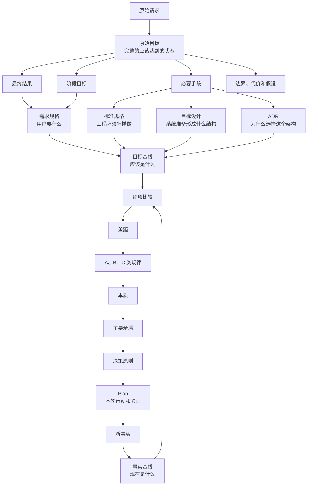
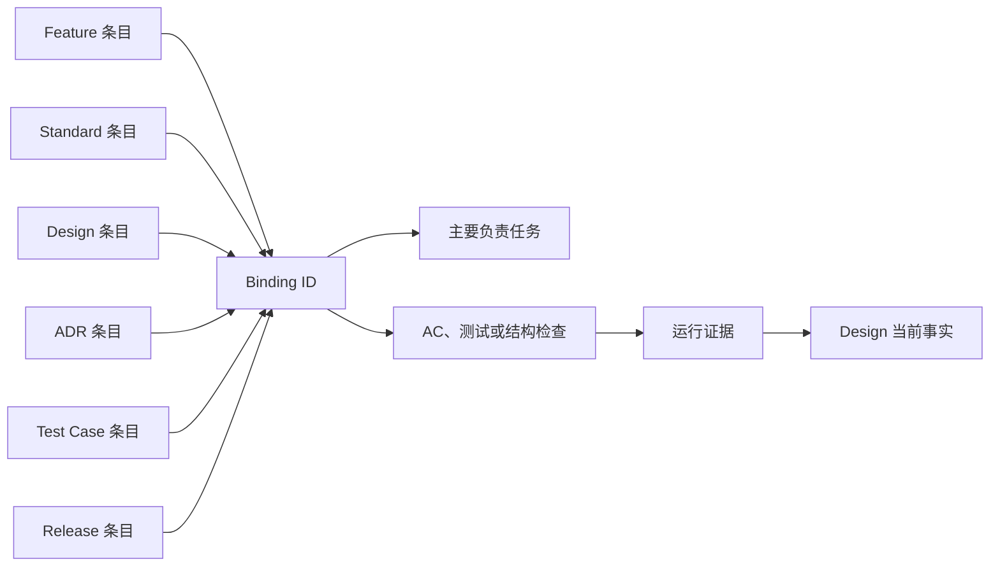
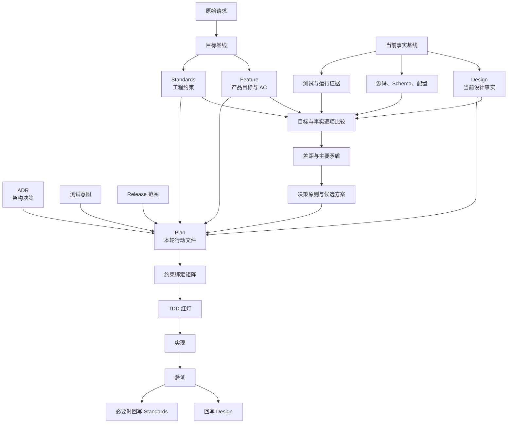
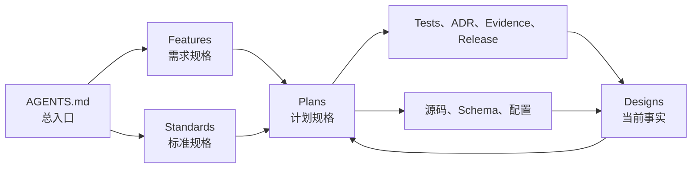
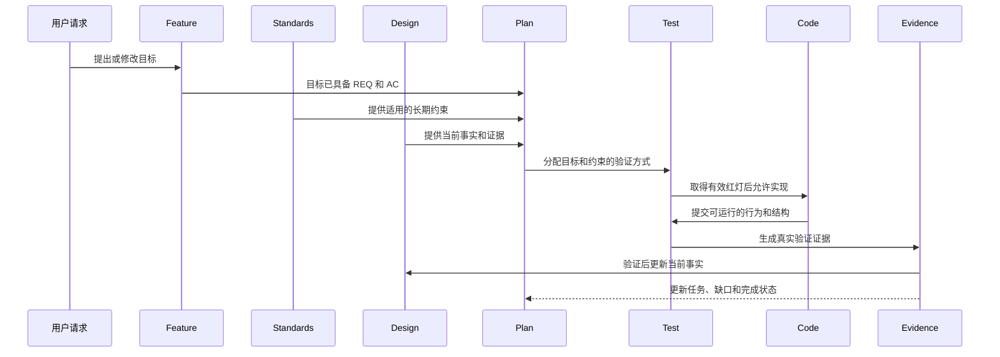
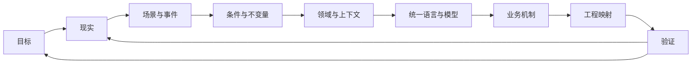
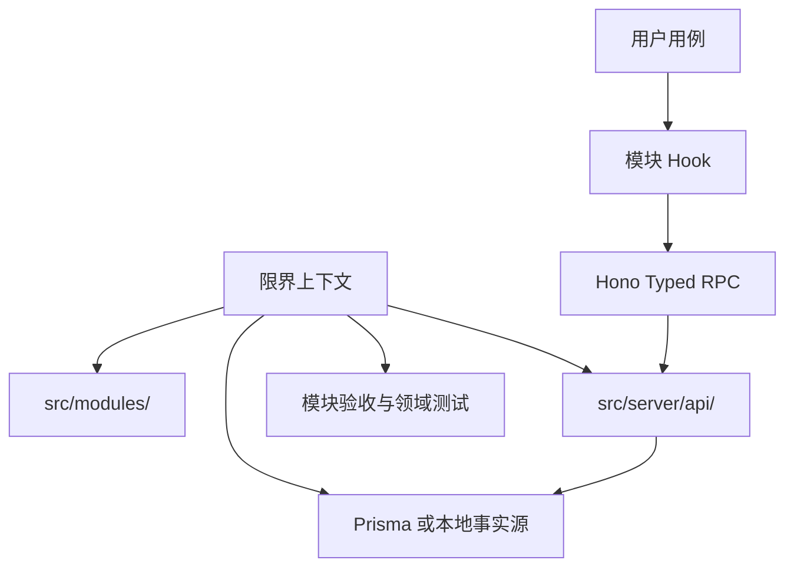
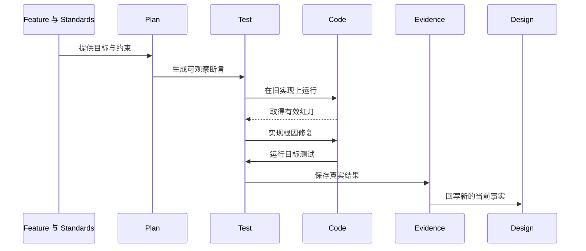

# 从规格到实现的 DDD 架构闭环

## 0. 文档控制

| 项目     | 内容                                                         |
| -------- | ------------------------------------------------------------ |
| 文档状态 | 初稿，可评审                                                 |
| 文档范围 | Ignite 模板的文档体系、DDD 模块和开发闭环                    |
| 主要来源 | 项目现有规则、用户讨论、DDD 方法材料                         |
| 适用对象 | 产品、设计、工程、测试和 AI 执行者                           |
| 非目标   | 不定义白纸英语的具体业务规则，不替代 Feature、Plan 或 Design |

本文只描述一件事。

> 如何把一个原始需求，经过目标、事实、矛盾、决策、Plan 和验证，变成可靠的实现，并把验证后的事实写回系统。

本文是模板级架构文档。它不是某一个业务模块的产品规格，也不是新的任务管理工具。

## 1. 这份文档解决什么问题

当前工程文档已经有 Feature、Plan、Design、Standards、测试和证据。但是，文档存在不等于约束已经传到代码。

本文件定义它们之间的连接方式。

它要防止下面这些问题：

- 需求写过了，Plan 没有覆盖全部条件。
- Plan 创建了，但没有说明它在解决哪个主要矛盾。
- 任务完成了，但没有对应的测试。
- 测试通过了，但没有证明原始目标已经达成。
- Design 写了未来方案，却被误当成当前事实。
- 多个页面各自实现同一个组件，结果位置、状态和交互不一致。
- 一个模块里的词语、规则和数据责任被另一个模块偷偷改变。

## 2. 一句话规则

任何实现都必须能够沿着下面的链路被追溯：

```text
原始请求
→ 目标基线
→ 当前事实
→ 差距与主要矛盾
→ 决策原则
→ Plan 任务
→ TDD 与验收证据
→ 新的当前事实
```

其中任何一段断开，都不能把任务视为完成。

## 3. 两套结构不能混在一起

本项目同时使用两套结构。

第一套结构是解决问题的方法。它说明问题应该怎样被想清楚。

第二套结构是仓库里的文件职责。它说明不同信息应该保存在哪里。

两套结构有关联，但不是一一对应。

### 3.1 五步问题解决方法

| 步骤    | 要回答的问题             | 产出                 |
| ------- | ------------------------ | -------------------- |
| 1. 目标 | 应该达到什么状态         | 目标、成功标准、边界 |
| 2. 现象 | 现在实际是什么状态       | 事实、证据、未知     |
| 3. 矛盾 | 为什么没有达到目标       | 差距、原因、主要矛盾 |
| 4. 原则 | 应该按照什么标准选择     | 取舍原则和工程约束   |
| 5. 行动 | 谁在什么时候改变什么条件 | Plan、任务和验证     |

这五步来自通用的问题解决方法。它们不是五个仓库目录。

### 3.2 仓库文件的职责

| 文件位置                  | 它保存什么                             | 它不能代替什么               |
| ------------------------- | -------------------------------------- | ---------------------------- |
| `docs/features/`          | 产品目标、用户行为、业务边界和 AC      | 不能声称功能已经实现         |
| `docs/standards/`         | 长期适用的工程规则                     | 不能保存某一轮临时方案       |
| `docs/designs/`           | 当前系统的领域、架构、数据和运行事实   | 不能把未来方案写成当前事实   |
| `docs/plans/`             | 本轮目标、矛盾、决策、任务、测试和回写 | 不能替代长期规则和当前事实   |
| `docs/others/test-cases/` | 验收意图和可复验路径                   | 不能冒充测试已经通过         |
| `tests/`                  | 可执行的行为和工程检查                 | 不能单独定义产品目标         |
| `docs/others/evidence/`   | 实际运行产生的证据                     | 不能手写通过结果             |
| `docs/others/adr/`        | 需要长期保留的架构取舍和理由           | 不能记录普通任务安排         |
| `docs/plans/releases/`    | 多个 Plan 的组合范围和发布验收         | 不能替代单个 Plan 的实施证据 |

Feature、适用 Standards、已接受的 ADR 和 Design 中明确标记的目标设计，共同构成本轮的目标与约束来源。Design 的当前事实、源码、Schema、配置、测试和运行证据，共同构成当前事实来源。Plan 负责把这些来源逐条绑定到行动和验证。

## 4. 词义表和总体结构

### 4.1 词义表

本文件中的词只按下面的用法解释。不能把同一个词在不同段落中换成别的意思。

| 词           | 这里指什么                                                                                                                                                                                          | 不指什么                                               | 判断方法                                                                                     |
| ------------ | --------------------------------------------------------------------------------------------------------------------------------------------------------------------------------------------------- | ------------------------------------------------------ | -------------------------------------------------------------------------------------------- |
| 原始目标     | 本轮要最终实现的完整状态。它包括最终结果、阶段目标、必要条件、成功和失败标准、边界、代价与未验证假设。对本文这个架构问题，必要条件包括标准规格、需求规格、设计规格、架构决策、Plan 和验证之间的闭环 | AI 自己概括出的方向、单个 REQ 或任务标题               | 能指出原话来源，并能说明完整状态由哪些部分组成                                               |
| 原始请求     | 用户发来的完整消息，可能同时包含目标、原因、问题和操作要求                                                                                                                                          | 已经整理好的需求规格                                   | 能回到具体消息或输入材料                                                                     |
| 目标         | 原始目标拆出的一个可独立比较的“应该达到的状态”                                                                                                                                                      | “优化”“完善”“做好”这类没有对象和结果的词               | 有对象、条件、可观察结果、边界和来源                                                         |
| 最终结果     | 本轮问题最终要达到的状态                                                                                                                                                                            | 完成一个动作，或修改一个文件                           | 达到后，原始目标不再缺少必要结果                                                             |
| 阶段目标     | 为最终结果服务、且本轮必须先达到的中间状态                                                                                                                                                          | 最终结果本身，或一个没有结果的任务                     | 达到后能解除下一步的明确依赖                                                                 |
| 手段         | 为达到目标而采用的文档、规则、代码或协作方式                                                                                                                                                        | 目标本身                                               | 换一种手段仍可能达到同一目标                                                                 |
| 动作         | 由明确角色在明确条件下执行的具体行为                                                                                                                                                                | “加强”“优化”“处理一下”                                 | 能回答谁在什么时候做什么                                                                     |
| 成功标准     | 判断最终结果已经达到的条件                                                                                                                                                                          | 进度记录或主观感觉                                     | 检查通过后可以写成 `met`                                                                     |
| 推进标准     | 判断当前阶段正在向目标前进的条件                                                                                                                                                                    | 最终成功标准                                           | 在最终结果未出现时也能观察到变化                                                             |
| 失败标准     | 判断目标没有达到，或当前判断被推翻的条件                                                                                                                                                            | 一次环境故障或个人不满意                               | 出现后知道回到哪一层重新判断                                                                 |
| 边界         | 本轮明确处理和明确不处理的范围                                                                                                                                                                      | 把所有相关问题都放进来                                 | 能列出包含项、排除项和进入下一阶段的条件                                                     |
| 代价         | 达到目标需要付出的时间、复杂度、兼容性或维护成本                                                                                                                                                    | 把困难统称为风险                                       | 能说明接受什么、不接受什么                                                                   |
| 假设         | 尚未被事实验证、但当前方案暂时依赖的判断                                                                                                                                                            | 已验证事实                                             | 能写出验证方法和被推翻后的影响                                                               |
| 规格         | 对目标、规则或当前设计的明确文字约定                                                                                                                                                                | 一句愿望，或没有来源的建议                             | 读者能据此判断正确和错误                                                                     |
| 需求规格     | 描述用户需要什么行为和结果的规格                                                                                                                                                                    | 代码方案和任务清单                                     | 有 REQ、AC、边界和非目标                                                                     |
| REQ          | 一条稳定编号的业务要求                                                                                                                                                                              | 一段背景说明或一个实现步骤                             | 能独立说明一个必须满足的行为或条件                                                           |
| AC           | 验收条件，使用 Given、When、Then 描述可观察结果                                                                                                                                                     | “功能正常”或测试数量                                   | 能被一个真实检查判断通过或失败                                                               |
| 标准规格     | 跨多个任务稳定适用的工程规则                                                                                                                                                                        | 某一轮任务的临时选择                                   | 有适用条件、动作、足够结果和边界                                                             |
| 设计规格     | 对领域、架构、数据、接口或运行结构的明确描述                                                                                                                                                        | 产品愿望或任务进度                                     | 能指出当前事实、目标设计或两者的状态                                                         |
| 当前事实     | 在指定版本和证据下，系统实际已经具备的状态                                                                                                                                                          | 计划中的方案和用户希望的状态                           | 能指向源码、Schema、配置、测试或运行证据                                                     |
| 目标设计     | 尚未完成，但已经选定的设计状态                                                                                                                                                                      | 当前已经实现的事实                                     | 必须标记为目标，不能写入当前事实段落                                                         |
| 现象         | 在现实中出现、可以被观察或记录的情况                                                                                                                                                                | 对现象的原因解释                                       | 能描述发生了什么，不先说明为什么                                                             |
| 事实         | 已经通过观察、代码、测试或运行证据确认的现象                                                                                                                                                        | 用户说法、推测和未知                                   | 有可靠来源，其他人可以复查                                                                   |
| 说法         | 某个参与者声称发生了什么                                                                                                                                                                            | 已验证事实                                             | 保留说话者和原话，不能直接当作事实                                                           |
| 解释         | 对现象为什么发生的判断                                                                                                                                                                              | 现象本身                                               | 必须说明依据，也必须允许被反面证据推翻                                                       |
| 未知         | 现有材料不能判断的事情                                                                                                                                                                              | 为了让文档完整而补出的结论                             | 写明缺什么证据，不把它当作失败或事实                                                         |
| 反面证据     | 与当前解释不一致、能削弱该解释的事实                                                                                                                                                                | 只挑支持判断的例子                                     | 主动寻找后仍能说明当前判断是否成立                                                           |
| 趋势         | 同一现象在一段时间或不同条件下的变化方向                                                                                                                                                            | 一个时间点的快照                                       | 有时间、条件和变化记录                                                                       |
| 基线         | 本轮比较时固定使用的一组目标或事实                                                                                                                                                                  | 一句“目前情况”                                         | 写明来源、版本和比较范围                                                                     |
| 目标基线     | 本轮应该达到的结果、工程约束、目标设计和已接受决策的完整集合                                                                                                                                        | 只列一个 Feature 文件                                  | 每个来源条目都有 ID、状态和适用范围                                                          |
| 事实基线     | 在指定版本、环境和证据下，系统已经实际具备的完整集合                                                                                                                                                | Design 中没有来源的描述                                | 每个事实都能回到代码、Schema、配置、测试或运行记录                                           |
| 来源规格     | 来自 Feature、Standard、Design、ADR、测试意图或 Release 的一个具体条目                                                                                                                              | 一个目录名或整份文件的模糊引用                         | 有稳定 ID，并能单独判断是否适用                                                              |
| 本轮         | 一个 Plan 从准备到完成、阻塞、取消或被替代的工作范围                                                                                                                                                | 整个产品生命周期                                       | 有 Plan ID、范围、起点和结束状态                                                             |
| 主要负责任务 | 对某条绑定的条件变化负主要责任的任务                                                                                                                                                                | 所有参与过该文件的任务                                 | 任务完成后必须能证明对应条件已经改变                                                         |
| 强制项       | 如果没有满足，Plan 或 Release 就不能进入下一状态的条目                                                                                                                                              | 普通建议或未来想法                                     | 在准入检查中有明确失败结果                                                                   |
| 适用         | 某条规格确实会限制本轮工作                                                                                                                                                                          | 只要读到过，或看起来相关                               | Plan 记录适用理由；不适用也要写理由                                                          |
| 约束         | 如果不满足，目标就不能算完成的条件                                                                                                                                                                  | 一条可选建议                                           | 能指出违反后会出现什么错误                                                                   |
| 绑定         | 用稳定 ID 把一条来源规格接到一个 Plan 控制记录、任务和验证上                                                                                                                                        | 在 Plan 中提到一个文件名                               | 能从来源 ID 找到任务、测试、证据和结果                                                       |
| 追踪         | 沿着来源、任务、测试、证据和事实回写逐项查找                                                                                                                                                        | 一张没有来源的总表                                     | 每个节点都有上游和下游链接                                                                   |
| 收束         | 把本轮所有适用来源逐条放进同一张绑定矩阵，再变成任务和验证                                                                                                                                          | 把不同文件的文字复制到 Plan                            | 每条来源都有 Binding ID、主要任务和验证方式                                                  |
| 差距         | 目标状态与当前事实之间的可描述差异                                                                                                                                                                  | 对差异的原因解释                                       | 能分别写出“应该是什么”和“现在是什么”                                                         |
| 本质         | 用最少的机制说明一组现象为什么会发生，并能指导下一步选择                                                                                                                                            | “系统复杂”“人性如此”这类不能产生判断的词               | 能解释现象、生成现象、指导行动，并有明确适用范围                                             |
| A 类客观规律 | 当前系统不能改变，只能顺应或利用的运行规律                                                                                                                                                          | 人为制定的规则和个人判断                               | 改变它的尝试通常无效，顺应它能改变结果                                                       |
| B 类社会规则 | 人或组织建立的规则、环境和群体安排                                                                                                                                                                  | 天然规律                                               | 可以改变、绕开或更换，并能说明责任者                                                         |
| C 类主观判断 | 个体对事实、结果或因果的判断                                                                                                                                                                        | 已经验证的事实                                         | 可以用场景、实验或反例验证和修正                                                             |
| 主要矛盾     | 在限定范围内，两个真实存在、方向相反、相互制约的条件之间的冲突。它是当前最阻碍目标的那组冲突                                                                                                        | 一个表面缺陷、一个差距、一个文件名或一个未经验证的原因 | 必须有目标和事实对照，有双方条件，有事实依据，能解释多个现象，能指导取舍，并能被验证结果推翻 |
| 次要矛盾     | 真实存在但当前阻碍程度低于主要矛盾，或必须在主要矛盾解决后处理的冲突                                                                                                                                | 可以忽略的杂项或尚未证明的问题                         | 写明它为什么不是当前主要矛盾，以及何时升级                                                   |
| 决策原则     | 根据主要矛盾、本质和相关规律形成的取舍标准。它回答优先什么、保留什么、排除什么                                                                                                                      | 具体任务，或未经比较的方案                             | 写明来源、适用对象、保留项、排除项和理由；A 类顺应，B 类改变或绕开，C 类验证或修正           |
| 方案         | 为解决主要矛盾而提出的完整做法                                                                                                                                                                      | 一个动作或一个技术名词                                 | 写明保护的目标、依赖的条件、失败方式、代价和替代方案                                         |
| 行动方案     | 根据决策原则安排的具体行动。它必须写清谁、何时、做什么、改变哪个条件和如何验证                                                                                                                      | “努力”“优化”“继续观察”                                 | 每个动作都能回到一个原则，并能检查动作、条件、目标和代价                                     |
| 改变条件     | 行动真正要改变的资源、关系、输入、规则、状态或环境                                                                                                                                                  | 动作本身                                               | 动作完成后，条件应有可观察变化                                                               |
| 决策         | 在候选方案中选定一个方案，并留下理由和代价                                                                                                                                                          | 一个还没有比较过的想法                                 | 有候选、选择理由、代价和复审条件                                                             |
| ADR          | 需要在未来继续保留的架构决策记录                                                                                                                                                                    | 普通任务安排或一次性修复笔记                           | 写入 `docs/others/adr/`，并说明替代方案                                                      |
| Plan         | 本轮把所有适用规格收束成行动、测试和回写的执行文件                                                                                                                                                  | 所有长期规格的替代品                                   | 每条适用来源都有绑定记录和负责任务                                                           |
| 任务         | Plan 中一个有结果、范围、依赖、负责人和验证的行动单元                                                                                                                                               | “优化系统”这类模糊标题                                 | 做完后能观察到结果，失败时知道缺什么                                                         |
| 测试意图     | 说明要验证哪个 AC、风险和用户路径                                                                                                                                                                   | 已经通过的测试结果                                     | 能指向具体 AC 和真实测试入口                                                                 |
| 红灯         | 在未实现或旧实现上，目标测试真实失败                                                                                                                                                                | 编译错误、环境没启动或测试脚本找不到                   | 失败来自目标断言，并绑定到 AC                                                                |
| 证据         | 真实运行产生的版本、环境、输入和结果记录                                                                                                                                                            | 手写的“已通过”或截图说明本身                           | 能核对被测版本和运行命令                                                                     |
| 回写         | 验证后更新拥有该信息的真源                                                                                                                                                                          | 只在 Plan 里写一句完成                                 | 更新 Design、Standard、Feature 或 ADR 的正确位置                                             |
| 完成         | 本轮所有绑定目标和必要约束都有有效验证，且完成必要回写                                                                                                                                              | 代码能编译，或任务状态被改成 done                      | 追踪矩阵没有未处理的强制项                                                                   |
| 延期         | 明确知道要做，但本轮不做，仍然未完成                                                                                                                                                                | 已解决或允许忽略                                       | 有原因、影响和后续责任                                                                       |
| 排除         | 有权决定的人明确同意不属于本轮                                                                                                                                                                      | 因为没做、不会做或忘了做                               | 有授权来源和排除理由                                                                         |
| 模块         | 拥有一组固定信息、规则和交接责任的边界                                                                                                                                                              | 一个任意文件夹或页面                                   | 能说清它拥有和不拥有的内容                                                                   |
| 领域         | 一组相同问题、规则、术语和责任的范围                                                                                                                                                                | 一个技术目录的名字                                     | 模块内的词义和规则保持一致                                                                   |
| DDD          | 先从真实问题、场景、规则和责任建立模型，再决定软件结构的方法                                                                                                                                        | 把每个目录都命名成领域对象                             | 模型能解释现实、指导设计并接受验证                                                           |
| 子域         | 一个领域中可以独立描述问题、价值和责任的部分                                                                                                                                                        | 任何子目录                                             | 有自己的问题、规则和边界                                                                     |
| 限界上下文   | 一组词义、模型和规则保持一致的边界                                                                                                                                                                  | 自动拆出的微服务或文件夹                               | 能指出哪些词在边界内有效，以及边界外如何协作                                                 |
| 统一语言     | 同一上下文中对同一对象使用稳定的词和定义                                                                                                                                                            | 让所有上下文使用同一套词                               | 同一词在同一上下文不发生多重含义                                                             |
| 实体         | 有持续身份和生命周期的领域对象                                                                                                                                                                      | 任何名词或数据库表                                     | 即使属性变化，仍能确认是同一个对象                                                           |
| 值对象       | 由属性整体定义、没有独立身份的对象                                                                                                                                                                  | 为了复用而抽出的普通类型                               | 属性相同时可视为同一个值，改变时整体替换                                                     |
| 聚合         | 必须在同一个业务一致性边界内一起保持的对象组                                                                                                                                                        | 一张表或一组数据库关联                                 | 外部只能通过聚合根改变内部状态                                                               |
| 聚合根       | 聚合对外提供的唯一入口                                                                                                                                                                              | 任意父对象                                             | 外部请求通过它保护聚合不变量                                                                 |
| 领域服务     | 无法自然归属某个实体或聚合、但属于领域的协调规则                                                                                                                                                    | 为每个动词创建一个服务                                 | 能说明为什么不能归属现有对象                                                                 |
| 领域事件     | 领域中已经发生并影响后续责任的状态变化                                                                                                                                                              | 点击、写表或调用服务                                   | 能回答发生了什么业务变化                                                                     |
| 上下文映射   | 说明两个上下文如何交付、翻译、同步和处理失败                                                                                                                                                        | 一条模块 import 关系                                   | 写明上游、下游、数据含义、实时性和失败影响                                                   |
| 机制         | 让某个规则在重复运行、失败和恢复后仍成立的因果过程                                                                                                                                                  | 一个类名或一句口号                                     | 写明输入、判断、输出、责任、失败和恢复                                                       |
| 应用层       | 组织一次完整用例的流程，不拥有核心业务规则                                                                                                                                                          | 所有业务代码的上层目录                                 | 负责调用顺序、权限入口和事务边界                                                             |
| 领域层       | 保存领域对象、规则和不变量                                                                                                                                                                          | 一个必须存在的代码层                                   | 规则不依赖页面和具体外部适配器                                                               |
| 基础设施层   | 连接数据库、网络、文件和第三方系统的技术适配                                                                                                                                                        | 业务规则的存放位置                                     | 技术替换时不改变领域含义                                                                     |
| 接口层       | 接收外部输入并返回外部结果的边界                                                                                                                                                                    | 业务流程本身                                           | 负责协议、输入输出和错误转换                                                                 |
| 事件         | 已经发生的、能改变后续工作的状态变化                                                                                                                                                                | 页面点击、数据库写入或服务名                           | 能回答“发生了什么变化”                                                                       |
| 命令         | 要求某个变化发生的请求                                                                                                                                                                              | 已经发生的结果                                         | 能回答“谁请求改变什么”                                                                       |
| 不变量       | 在整个流程中不能被破坏的条件                                                                                                                                                                        | 某个实现细节                                           | 违反后，业务或工程结果就不成立                                                               |

如果一个词不能放进这张表，先不要在 Plan 或 Design 中使用它。先补定义，或换成更具体的词。

例如，用户说“切换背词、写作和学语法时，顶部栏必须在同一个位置，并且状态不能丢失”。这段话是原始目标的来源。“统一工作台”只是后来的概括，不能替代这段具体要求。

“优化”“完善”“稳定”“一致”“支持”不能单独作为目标。它们必须写出对象、条件和可观察结果。例如，“顶部栏位置一致”必须继续说明在哪些入口、哪些视口和什么结果下算一致。

### 4.2 概念之间的关系

这些词不是一组并列标签。它们有先后关系，也有上下层关系。



#### 原始目标不是一个文件名

“原始目标”是本轮最终要实现的完整状态。它不是“写一个 Feature”，也不是“创建一个 Plan”。

对于本文正在解决的问题，原始目标可以写成：

> 用一套有明确职责的标准规格、需求规格、设计规格、架构决策、计划规格、测试和证据，描述 AI 开发所需的上下文和约束。让每条约束都能进入本轮 Plan，绑定到任务和测试，并在验证后回写成当前事实。

这句话还要继续拆成：

| 原始目标的一部分 | 在本文中具体是什么                                                                             |
| ---------------- | ---------------------------------------------------------------------------------------------- |
| 最终结果         | AI 能根据完整文档知道要达到什么、现在是什么、要改什么和怎样验证                                |
| 阶段目标         | 先把五层文档的职责、关系和绑定规则定义清楚                                                     |
| 必要条件         | `standards`、`features`、`plans`、`designs`、`others` 各有唯一职责，且 Plan 能逐条接住适用约束 |
| 手段             | README 规则、REQ/AC、Design、Plan、测试、Evidence 和工具检查                                   |
| 成功标准         | 每条适用规格都有来源、绑定、任务、验证和事实回写                                               |
| 失败标准         | 只创建了 Plan，但存在未绑定的规格，或测试通过后仍无法证明目标                                  |
| 边界             | 本文只定义模板的文档治理和执行闭环，不定义白纸英语的业务内容                                   |
| 代价             | 文档和工具需要维护绑定关系，准备阶段会比直接改代码多一些工作                                   |
| 假设             | 这些文档会由 AI 和开发者按所属 README 维护，并由工具逐步检查                                   |

标准规格、需求规格、设计规格和架构决策是原始目标的必要组成部分，但它们不是四个并列的最终目标。它们分别描述用户结果、工程条件、系统结构和选择理由。

#### 目标、规格、Plan 不是同一个东西

| 词   | 关系                                     |
| ---- | ---------------------------------------- |
| 目标 | 说明最终要达到什么状态                   |
| 规格 | 把目标写成一条可被判断的约定             |
| Plan | 把本轮适用的多条规格接成行动、测试和回写 |
| 实现 | 改变系统条件，使目标状态出现             |
| 验证 | 检查目标状态和必要约束是否真的出现       |

因此，Plan 不是目标的来源，也不是规格的替代品。Plan 是本轮对多种规格的行动收束。

#### 目标和事实必须按同一维度比较

目标和事实不能只做整体印象比较。目标写了什么维度，事实就必须调查同样的维度。

| 目标维度 | 事实维度                           | 比较结果             |
| -------- | ---------------------------------- | -------------------- |
| 最终结果 | 当前用户或系统实际得到的结果       | 是否已经达到         |
| 阶段目标 | 当前阶段完成了什么                 | 是否可以进入下一阶段 |
| 成功标准 | 当前有哪些测试或运行证据           | 是否可以判定成功     |
| 推进标准 | 当前趋势和中间结果                 | 是否正在向目标移动   |
| 失败标准 | 当前反面证据和失败记录             | 是否已经失败         |
| 代价边界 | 实际时间、复杂度、兼容性和维护成本 | 是否仍然可接受       |
| 约束     | 当前结构和行为                     | 是否违反工程规则     |

这就是“逐一对应”的第一层含义。没有相同维度，就不能直接判断差距。

#### 主要矛盾不是“问题最大的地方”

主要矛盾必须从目标和事实的对照中产生，并且满足以下条件：

| 条件     | 必须达到的要求                                                 |
| -------- | -------------------------------------------------------------- |
| 有目标   | 已经明确本轮应该达到的状态                                     |
| 有事实   | 已经确认当前实际状态，而不是只引用说法                         |
| 有双方   | 能写出互相牵制的两股力量、条件或做法                           |
| 有冲突   | 两边不能在当前条件下同时成立                                   |
| 有范围   | 只针对当前问题和当前阶段，不扩张成世界结论                     |
| 有依据   | 事实、反面证据、趋势或已知规律支持它                           |
| 有解释力 | 能解释当前多个重要现象，而不是只解释一个表面缺陷               |
| 有生成力 | 能说明这些现象为什么会反复出现                                 |
| 有指导力 | 能推出下一步应该顺应、改变、绕开、验证或修正什么               |
| 有简洁性 | 用尽量少的关键条件解释主要现象，不把互不相关的问题拼成一个矛盾 |
| 可推翻   | 新的事实或测试能够证明它判断错了                               |

例如，下面这句话不是主要矛盾：

```text
顶部栏位置不一致。
```

它只是一个差距。

下面这句话才接近主要矛盾：

```text
目标要求不同学习模式共享同一个工作台结构。
当前实现却让每个模式分别拥有自己的布局和状态来源。
统一结构与局部所有权在当前实现中不能同时成立。
```

这句话还要继续用事实验证。若发现三个模式其实共享同一个布局根节点，只是 CSS 计算错误，那么原来的主要矛盾就被推翻，问题应回到事实和实现层。

一个问题可以同时存在多个矛盾。当前阶段最阻碍目标的那一个叫主要矛盾，其他矛盾记录为次要矛盾。主要矛盾变化后，Plan 必须重新排序，不能继续沿用旧的优先级。

#### 主要矛盾、本质和规律的关系

三者不能互相替代。

```text
现象是看到了什么。
本质是这些现象由什么机制产生。
主要矛盾是当前最阻碍目标的两股冲突力量。
决策原则是根据矛盾和规律应该怎样取舍。
行动方案是把取舍变成谁在什么时候改变什么条件。
```

第三层分析还必须区分三种对象：

| 类型         | 处理方式                   | 工程中的例子                     |
| ------------ | -------------------------- | -------------------------------- |
| A 类客观规律 | 不能直接改，只能顺应或利用 | 延迟反馈会降低行动意愿           |
| B 类社会规则 | 可以改变、绕开或更换       | 团队规定所有页面必须使用共享壳层 |
| C 类主观判断 | 需要用场景、实验或反例验证 | “这个组件一定只能放在页面内部”   |

如果把 B 类规则当成 A 类规律，团队会把可改的规则当成不可改的限制。如果把 C 类判断当成事实，Plan 就会在未经验证的前提上行动。

#### 决策原则和行动方案的关系

决策原则不是任务。它必须来自主要矛盾、本质和三类规律，并回答：

- 优先什么。
- 保留什么。
- 排除什么。

行动方案再回答：

- 谁来做。
- 什么时候做。
- 做什么。
- 改变哪个条件。
- 用什么指标判断条件是否改变。

因此，不能从“顶部栏不一致”直接跳到“抽出一个共享组件”。中间还必须说明主要矛盾、共享边界的工程原则、候选方案的取舍和验证方式。

#### 规格在 Plan 中怎样形成绑定



每条来源规格先形成一个 Binding ID，再连接任务、检查和证据。Plan 不是把各个文件复制一遍，而是保留这些来源之间的关系。

### 4.3 总体架构



这条链路有两个方向。

正向方向把目标变成实现。

反向方向把验证后的实现写回当前事实和长期规则。

## 5. 两条基线

### 5.1 目标基线

目标基线描述本轮必须达到什么状态，以及实现必须遵守哪些条件。

它有两个来源。

| 来源     | 说明                   | 示例                         |
| -------- | ---------------------- | ---------------------------- |
| 产品目标 | 用户要得到什么行为     | 三种学习模式使用统一工作台   |
| 工程目标 | 系统必须遵守什么结构   | 页面不能各自复制工作台外壳   |
| 架构决策 | 已经接受的长期设计取舍 | 共享工作台由一个外壳拥有     |
| 目标设计 | 本轮要形成的技术结构   | 三个入口使用同一个布局根节点 |

产品目标写入 Feature。工程目标写入 Standards。长期架构取舍写入 ADR。目标结构写入 Design 的目标设计段落。

一个具体任务必须同时检查这两类目标。只检查产品行为，不检查工程约束，仍然可能留下重复实现、多个状态源或错误的模块边界。

设计必须能承载目标：一份设计如果不能说明它支撑哪条目标、代价是什么、放弃了什么，就不能当作目标设计使用。

### 5.2 当前事实基线

当前事实描述系统现在实际上是什么样。

事实必须有来源。来源可以是：

- 源码。
- Schema。
- 配置。
- 可执行测试。
- 真实运行结果。
- 已发布的证据。
- 用户明确描述的现状。

下面四种内容必须分开记录：

| 类型       | 含义                       | 示例                         |
| ---------- | -------------------------- | ---------------------------- |
| 已验证事实 | 有代码、测试或运行结果支持 | 三个页面分别渲染自己的顶部栏 |
| 用户说法   | 用户对现状的描述           | 用户说禅模式没有保留红色状态 |
| 工程推测   | 对原因的解释               | 可能存在两个状态来源         |
| 未知       | 目前没有足够证据           | 尚未确认哪个组件拥有状态     |

Design 保存当前事实。未来方案可以出现在 Design 的目标设计段落，但必须明确标记为目标，不能和当前事实混写。

## 6. 目标、事实和约束绑定矩阵

“逐一对应”不是指一个目标只能对应一条代码，也不是把整个 Feature 文件粗略地写进 Plan。

它指本轮范围内的每一条 REQ、AC、适用 Standard、适用 Design 约束和已接受的 ADR，都必须建立一条唯一的绑定记录。绑定记录再连接任务、测试、证据和结果。

一条来源规格可以由多个任务共同完成。一个任务也可以同时处理多条来源规格。但每条来源规格必须有一个明确的主要负责任务，不能只写“相关文件见上文”。

没有绑定 ID 的规格，不得进入 Plan 的完成状态。

### 6.1 矩阵字段

| 字段            | 要回答的问题                                            |
| --------------- | ------------------------------------------------------- |
| `Source ID`     | 这条记录对应哪个 REQ、AC、STD、DES、ADR 或 Release 条目 |
| `Source`        | 这条条目位于哪个真源文件                                |
| `Binding ID`    | 本轮用哪个绑定记录承接它                                |
| `Applicable`    | 为什么这条规格适用于本轮，或为什么不适用                |
| `Target`        | 这一条来源要求什么结果                                  |
| `Current`       | 当前实际是什么状态                                      |
| `Evidence`      | 当前事实的证据在哪里                                    |
| `Status`        | 已满足、部分满足、未满足、未知、冲突、延期或排除        |
| `Gap`           | 目标和事实差在哪里                                      |
| `Contradiction` | 哪个相互冲突的条件阻止了目标                            |
| `Decision`      | 本轮选了什么方案，理由是什么                            |
| `Task`          | 哪个任务改变哪个条件                                    |
| `AC/Test`       | 哪个验收或测试证明结果                                  |
| `Result`        | 验证后发生了什么                                        |

### 6.2 示例

下面的记录只是说明写法。编号不是当前项目已经存在的正式编号。

| Source ID           | Source                           | Binding ID | Target                       | Current                | Task                             | AC/Test                                |
| ------------------- | -------------------------------- | ---------- | ---------------------------- | ---------------------- | -------------------------------- | -------------------------------------- |
| `REQ-WORKSPACE-001` | `docs/features/workspace.md`     | `BIND-001` | 三种模式使用同一个顶部栏位置 | 每个模式各自实现顶部栏 | 建立共享工作台外壳并迁移三个模式 | 切换模式后顶部栏位置和状态一致         |
| `STD-ARCH-001`      | `docs/standards/architecture.md` | `BIND-002` | 共享组件只有一个布局所有者   | 三个页面分别计算布局   | 删除重复布局计算                 | 结构检查确认模式页面不再拥有顶部栏布局 |

### 6.3 状态定义

| 状态       | 含义                           |
| ---------- | ------------------------------ |
| `met`      | 有效证据证明目标已经满足       |
| `partial`  | 目标只满足一部分               |
| `missing`  | 已确认目标没有满足             |
| `unknown`  | 没有足够证据判断               |
| `conflict` | 文档、实现或用户决定互相冲突   |
| `deferred` | 有明确理由暂不处理，仍然未完成 |
| `excluded` | 有明确授权排除，不属于本轮范围 |

没有证据不能写成 `met`。没有用户授权不能把 `deferred` 改成 `excluded`。

## 7. 差距和主要矛盾

### 7.1 差距不是主要矛盾

差距描述结果不一致。

主要矛盾解释这种不一致为什么一直出现。

例如：

```text
差距
切换模式后，顶部栏的位置和状态不一致。

当前事实
三个页面各自拥有一套顶部栏和布局计算。

主要矛盾
统一工作台要求与模式局部布局所有权冲突。

解决方向
让工作台统一拥有共享外壳、布局和跨模式状态。
```

Plan 必须写出主要矛盾。只列“需要修改哪些文件”不算完成分析。

### 7.2 主要矛盾的写法

使用下面的句式：

```text
目标要求 A。
当前结构依赖 B。
B 会持续造成 C。
因此 A 与 B 之间形成主要矛盾。
```

Plan 中写出的主要矛盾，至少要同时保留以下信息：

- 本轮的目标是什么。
- 当前事实是什么。
- 互相牵制的两边分别是什么。
- 两边为什么不能在当前条件下同时成立。
- 哪些事实、反面证据或趋势支持这个判断。
- 它为什么比其他差距更阻碍当前目标。
- 它如何解释多个重要现象。
- 它会把任务和验证引向什么条件变化。
- 什么新事实会推翻它。

## 8. 文档治理领域的 DDD 模块

本文讨论的领域不是白纸英语的词汇、写作或语法业务。

本文讨论的是模板自己的文档治理与工程执行系统。这个系统负责把需求变成实现，再把验证后的事实写回文档。

因此，图中的 `standards`、`features`、`plans`、`designs` 和 `others` 才是本文要说明的领域模块。白纸英语的 `Vocabulary`、`Writing` 和 `Grammar` 是使用这套系统的业务模块，不是本文第 8 节的模块。

### 8.1 一个文档治理模块必须说清楚什么

每个模块都必须有自己的目标、输入、输出、责任和验收标准。

| 内容     | 要回答的问题                         |
| -------- | ------------------------------------ |
| 模块目标 | 这个模块在整个开发闭环中解决什么问题 |
| 输入     | 哪些信息可以进入这个模块             |
| 输出     | 它必须交给哪个模块什么结果           |
| 责任     | 哪类信息只能由它负责维护             |
| 非责任   | 哪些信息不能写进来                   |
| 内部结构 | 模块内部必须有哪些字段、章节或记录   |
| 规则     | 哪些条件必须一直成立                 |
| 事实源   | 判断当前状态时依据什么               |
| AC       | 怎样判断这个模块本身写对了           |
| 交接     | 上游和下游怎样使用它的结果           |

文档模块之间也有领域边界。`Feature` 不能维护当前代码事实。`Design` 不能代替产品需求。`Plan` 不能把临时任务变成长期规则。

### 8.2 模板中的实际领域模块

下面的模块来自当前模板的文档结构。它们不是页面，也不是微服务。

| 模块 ID | 目录或文件                  | 主要责任                                         | 不负责什么                                 |
| ------- | --------------------------- | ------------------------------------------------ | ------------------------------------------ |
| `D0`    | `AGENTS.md`                 | 规定总入口、读取顺序、协作边界和执行方式         | 不保存具体产品需求、当前代码事实或任务状态 |
| `D1`    | `docs/features/`            | 保存用户目标、业务规则、模块边界和验收意图       | 不记录实现过程，不声称功能已经完成         |
| `D2`    | `docs/standards/`           | 保存长期适用的工程规则、文档规则和质量门槛       | 不保存某一轮任务的临时决定                 |
| `D3`    | `docs/plans/`               | 把目标、事实和矛盾转成当前一轮的决策、任务和验证 | 不替代长期标准，不保存未经验证的当前事实   |
| `D4`    | `docs/designs/`             | 保存当前系统的领域、架构、API、数据库和运行事实  | 不把未来方案写成已经实现                   |
| `D5`    | `docs/others/`              | 保存 ADR、测试意图、输入材料、证据和其他治理记录 | 不重新定义 Feature、Plan 或 Design 的职责  |
| `D6`    | `src/`、`prisma/`、`tests/` | 提供可执行事实、数据事实和验证事实               | 不替代上游的目标、原则和决策记录           |

`docs/plans/releases/` 属于 `D5` 的发布治理内容，但它仍然遵守 Plan 和 Release 自己的 README 规则。

模块编号 D0–D6 已定义：D0 是执行入口，D1–D5 是五个文档模块，D6 是可执行事实边界。本文的核心是五个文档模块 `D1` 到 `D5`。`D0` 是所有模块共用的执行入口，`D6` 是文档之外的可执行事实边界。它们不是五层文档中的额外文档层。

文件夹的排列顺序也不是工作顺序。一次新的产品工作通常从 `D1` 开始，读取 `D2` 和 `D4`，由 `D3` 形成执行方案，再由 `D5` 保存验证、决策和发布记录。

`D5` 是一个治理模块组，不是一个共享全部对象的单一模型。测试用例、ADR、Evidence 和 Release 各自拥有自己的对象和规则，只因为它们都服务于交付治理，才放在同一组中。

### 8.3 每个文档模块内部怎样工作

每个模块都必须形成自己的输入、处理、输出和 AC。下面的 AC 是模块级最低要求。具体文件仍然必须遵守所属目录 README 的完整规则。

| 模块            | 输入                                                           | 内部处理                                                                 | 输出                             |
| --------------- | -------------------------------------------------------------- | ------------------------------------------------------------------------ | -------------------------------- |
| `D0` 执行入口   | 用户请求、仓库规则、当前会话                                   | 判断请求类型，找到唯一的所属 README 和方法入口                           | 下一步应该读取和维护什么         |
| `D1` 需求规格   | 用户原话、业务材料、已确认决定                                 | 区分最终结果、阶段目标、手段和动作，再拆成 REQ 和 AC，写边界和非目标     | 可以验收的产品目标               |
| `D2` 标准规格   | 重复失败、架构原则、工程约束                                   | 判断是否长期适用，写适用条件、动作、结果和边界                           | 可复用的工程标准                 |
| `D3` 计划规格   | Feature、Standards、Design、ADR、测试意图、Release、源码和证据 | 建立目标与事实矩阵，找主要矛盾，选方案，为每条适用来源建立绑定，再拆任务 | 可执行、可验证、可回写的 Plan    |
| `D4` 设计规格   | 源码、Schema、配置、测试和运行证据                             | 还原当前领域、数据、接口和架构事实，分开标记目标设计                     | 当前系统事实                     |
| `D5` 治理记录   | Feature、Plan、测试运行和架构取舍                              | 保存测试意图、ADR、运行证据和 Release 覆盖                               | 决策记录、验证记录和组合范围     |
| `D6` 可执行事实 | 已批准的 Plan 和红灯证据                                       | 修改代码、Schema、配置，执行测试和运行检查                               | 新的代码事实、测试结果和运行证据 |

| 模块            | 内部必须包含                                                            | 模块级 AC                                                                                                                                         |
| --------------- | ----------------------------------------------------------------------- | ------------------------------------------------------------------------------------------------------------------------------------------------- |
| `D0` 执行入口   | 规则入口、读取顺序、职责分流、权限边界                                  | 给定一个请求，执行者能找到唯一的下一步入口；根规则不与子目录规则重复                                                                              |
| `D1` 需求规格   | 原始请求、目标分层、背景、用户目标、模块边界、REQ、AC、失败边界、非目标 | 原始目标有来源；每条重要 REQ 都有稳定编号和对应 AC；AC 使用 Given、When、Then；需求不写实现完成状态                                               |
| `D2` 标准规格   | 适用条件、必须动作、足够结果、边界、例外、正反例、维护入口              | 每条标准都能判断是否适用和是否满足；长期规则不包含某一轮的临时任务                                                                                |
| `D3` 计划规格   | 原始目标、目标与事实矩阵、主要矛盾、决策、任务、测试、回写和回退        | 每条适用来源规格都有 Binding ID 和主要负责任务，或有明确的不适用、延期或排除理由；每个任务有结果、范围、依赖、负责人、阶段和 AC；实现前先取得红灯 |
| `D4` 设计规格   | 当前事实、领域边界、数据归属、接口、架构约束、目标设计标记              | 当前事实有源码、Schema、配置、测试或证据来源；未来方案与当前事实分开；验证后才能把目标设计改成当前事实                                            |
| `D5` 治理记录   | 测试意图、ADR、输入资料、运行证据、Release 范围                         | 测试意图可追溯到 AC；证据只能由真实运行产生；ADR 写清替代方案和理由；Release 覆盖全部纳入目标                                                     |
| `D6` 可执行事实 | 代码、数据模型、测试、配置和运行结果                                    | 实现符合已批准的 Plan；测试调用真实入口；运行结果绑定被测版本，不能用文档状态冒充通过                                                             |

### 8.4 文档模块之间怎样交接



交接关系必须满足下面的条件：

- `D1` 提供产品目标和 AC。
- `D2` 提供适用的长期工程约束。
- `D4` 提供当前事实和事实证据。
- `D3` 负责比较三者，找出矛盾，并安排行动。
- `D5` 保存测试意图、架构理由、运行证据和组合范围。
- `D6` 产生可执行事实。
- `D4` 在验证完成后接收新的当前事实。

任何模块都不能跳过 `D3` 直接把上游内容变成代码。

### 8.4.1 文档模块之间的交接

每个模块交出什么、交给谁、缺了会怎样，如下表；交接断在哪里，链路就断在哪里。

| 上游     | 交出             | 下游               |
| -------- | ---------------- | ------------------ |
| Features | 需求与验收条件   | Plans              |
| Plans    | 任务、证据与回写 | Designs            |
| Designs  | 当前事实         | Standards 与 Plans |
| Others   | 决策与验收记录   | 全部模块           |

### 8.5 这个领域为什么需要 DDD

这个模板不是一个简单的文件夹集合。它有不同的角色、不同的责任和多条必须保持一致的关系：

- Feature 说明应该达到什么状态。
- Design 说明当前实际上是什么状态。
- Plan 负责解释两者为什么不一致，以及本轮怎样改变条件。
- Test、Evidence 和 Release 负责证明改变是否有效。
- Standards 和 AGENTS 负责让同类问题以后按同一规则处理。

这些内容会持续变化，也会发生跨模块协作。它们还存在一致性风险。例如，REQ 没有 AC，Plan 没有覆盖某条标准，或者 Design 把目标写成事实。这个复杂度足以使用 DDD 方法。

这里使用 DDD，不是为了给文档套上更多术语。DDD 只用来回答四个实际问题：

1. 每个文档模块究竟负责什么。
2. 模块内部保存哪些对象和规则。
3. 模块之间通过什么事件和交接协作。
4. 哪些条件必须由 AC 和工具持续检查。

### 8.6 每个模块的核心对象和不变量

下面的对象属于文档治理领域。它们不是要求代码中一定创建同名的类。它们先帮助我们确定责任和边界。

| 模块          | 核心对象                       | 主要命令                                            | 主要事件                                                               | 必须保护的不变量                                                             |
| ------------- | ------------------------------ | --------------------------------------------------- | ---------------------------------------------------------------------- | ---------------------------------------------------------------------------- |
| `D0`          | 执行入口、规则入口             | 读取请求、路由请求、读取方法                        | `RequestRouted`                                                        | 一个请求只有一个负责的规则入口；根规则和子规则不互相复制                     |
| `D1`          | Feature、REQ、AC               | 创建 Feature、增加 REQ、修改 AC、关闭需求           | `FeatureCreated`、`RequirementChanged`、`AcceptanceDefined`            | 每条重要 REQ 都有稳定编号和对应 AC；需求不写实现结果                         |
| `D2`          | Standard、适用条件、规则结果   | 新增标准、应用标准、修改标准、废弃标准              | `StandardAdded`、`StandardChanged`、`StandardDeprecated`               | 标准能判断适用和满足；临时任务不进入长期标准                                 |
| `D3`          | Plan、追踪记录、Task、Decision | 创建 Plan、准备 Plan、记录红灯、启动实现、验证 Plan | `PlanPrepared`、`RedRecorded`、`ImplementationStarted`、`PlanVerified` | 每条适用目标和标准都有去向；没有有效红灯不能进入实现；未解决缺口不能宣称完成 |
| `D4`          | 当前事实、目标设计、事实来源   | 记录事实、提出目标设计、根据证据更新事实            | `FactRecorded`、`DesignChanged`、`CurrentStateUpdated`                 | 当前事实和目标设计分开；事实必须有来源；没有证据不能升级为当前事实           |
| `D5` 测试     | 测试意图、测试路径             | 从 AC 建立用例、修改用例、执行检查                  | `TestIntentRecorded`、`VerificationProduced`                           | 测试意图能追溯到 AC；测试通过不能超出它声明的范围                            |
| `D5` ADR      | 架构决策、候选方案、理由       | 提出决策、接受决策、复审决策                        | `DecisionAccepted`、`DecisionSuperseded`                               | 只保存需要长期保留的取舍；必须写替代方案、代价和复审条件                     |
| `D5` Evidence | 运行、版本、环境、结果         | 执行检查、恢复运行、发布证据                        | `RunStarted`、`RunPassed`、`RunFailed`                                 | 证据来自真实运行，并绑定输入、环境和被测版本                                 |
| `D5` Release  | 发布范围、纳入项、延期项       | 纳入目标、延期目标、执行组合验收                    | `ScopeChanged`、`ReleaseVerified`                                      | 每个纳入目标都有 REQ、AC 和负责 Plan；延期不能伪装成完成                     |
| `D6`          | 源码、Schema、测试和配置       | 实现 Plan、运行测试、修改事实                       | `CodeChanged`、`SchemaChanged`、`TestExecuted`                         | 实现不能绕过已批准的 Plan；执行结果必须可以回到目标和任务                    |

这些对象之间不是任意引用关系。它们通过下面的业务事件交接：



## 9. 文档治理模块的 DDD 建模顺序

对核心五层中的任何一个模块进行新增或重大修改时，按下面的顺序建模。先描述现实，再引入软件术语。



### 9.1 目标

说明用户要得到什么结果，以及怎样判断成功。

### 9.2 现实

说明现在谁在什么条件下做什么。先记录事实，再记录解释。

### 9.3 场景和事件

按下面的顺序描述：

```text
已发生的变化
→ 发起变化的请求
→ 责任者或外部系统
→ 规则或策略
→ 后续变化
→ 分歧和热点
```

页面点击、数据库写入和服务名称不能自动算作领域事件。事件必须表示业务状态变化或业务明确记录的事实。

### 9.4 条件和不变量

条件说明结果依赖什么。

不变量说明哪些规则不能被破坏。

目标条件和实现手段必须分开。例如，“用户能保留原文”是目标条件，“使用某个数据库表”是实现手段。

### 9.5 领域和限界上下文

按业务问题、规则、术语、数据责任和变化边界划分。

限界上下文不自动等于微服务。当前项目优先使用模块化单体。只有当运行、部署、团队或故障边界真的需要隔离时，才考虑独立服务。

### 9.6 统一语言和模型

同一个上下文里，同一个词只能有一个稳定含义。

不同上下文里的相同词，如果含义不同，就不能强行共享同一个模型。

行为归属先用下面的句式检查：

```text
谁在什么条件下，对什么对象做了什么，必须保护哪个不变量？
```

只有当行为不能自然归属实体或聚合时，才提出领域服务。

### 9.7 机制

机制说明规则怎样反复成立。

每个机制必须写清：

- 保护哪个目标或不变量。
- 在什么条件下适用。
- 输入和输出是什么。
- 失败时谁负责收口。
- 怎样重试、补偿或恢复。
- 方案的成本和替代方案。
- 哪种变化会触发复审。

### 9.8 工程映射

工程映射不能反过来决定业务规则。

它负责说明已经确认的业务模型怎样落到软件：



当前模板保留下面的工程边界：

- Next.js route 负责页面组合。
- `src/modules/<module>/` 负责模块客户端能力。
- Module Hook 负责模块数据请求。
- Hono Typed RPC 负责类型安全的接口契约。
- Hono route 负责服务端边界和权限校验。
- Prisma 或本地适配器负责事实保存。
- 共享组件只承载真正跨模块的稳定能力。

不要为了形式填满应用层、领域层、基础设施层和接口层。只有存在真实变化隔离和责任边界时才增加一层。

## 10. Plan 把规格变成行动和验证

Plan 不是任务列表的集合。

Plan 必须把前面的判断写成可以执行和验证的行动文件。

### 10.1 Plan 的固定内容

| 部分         | 必须写什么                                                          |
| ------------ | ------------------------------------------------------------------- |
| 原始目标     | 用户原话或可追溯的原始来源，以及本轮要改变的可观察结果              |
| 来源规格     | 本轮适用的 Feature、Standards、Design、ADR、测试意图和 Release 条目 |
| 目标映射     | 每条 REQ 和 AC 对应哪个 Binding ID                                  |
| 工程约束     | 每条适用 Standard 和 Design 约束对应哪个 Binding ID                 |
| 当前事实     | 代码、Design 和证据说明了什么                                       |
| 主要矛盾     | 哪个条件最阻碍目标                                                  |
| 次要矛盾     | 哪些问题需要同时处理                                                |
| 决策原则     | 为什么选择当前方案                                                  |
| 方案比较     | 采用方案、替代方案、代价和复审条件                                  |
| 约束绑定矩阵 | 每条来源规格由哪个任务、测试和证据负责                              |
| 任务         | 每个任务的结果、范围、依赖、负责人和阶段                            |
| TDD          | 哪个 AC 先取得红灯                                                  |
| 验证         | 用什么测试和运行证据判断完成                                        |
| 回写         | 完成后更新哪些 Design、ADR 或 Standards                             |
| 回退         | 失败时怎样恢复，哪些数据或接口受影响                                |

Plan 是本轮适用规格的行动总表。它把 Feature、Standards、Design、ADR、测试意图和 Release 范围收束到同一张绑定矩阵中，但不取代这些文件的长期职责。

### 10.2 Plan 必须读取哪些来源

Plan 不能只对照 Feature。创建或接续 Plan 时，必须逐项检查下面的来源：

| 来源       | 需要读取什么                                       | 读完后写入 Plan 什么           |
| ---------- | -------------------------------------------------- | ------------------------------ |
| Feature    | 原始目标、REQ、AC、边界、失败行为和非目标          | 目标条目和 Binding ID          |
| Standards  | 会影响本轮文件、代码、数据、接口、测试或安全的规则 | 适用条目和不适用理由           |
| Design     | 当前实现事实、数据归属、接口、模块边界和目标设计   | 当前状态、证据和差距           |
| ADR        | 仍然有效的架构决策、替代方案和限制                 | 必须保留的决策约束             |
| Test cases | 已有验收意图、用户路径和失败边界                   | 复用或修改哪些测试意图         |
| Release    | 本轮是否属于某个发布范围，已有目标如何纳入         | included、deferred 或 excluded |
| 源码与证据 | 文档是否符合当前代码和运行结果                     | 事实来源和未知项               |

如果某个来源不适用，Plan 仍然要写出“不适用”和理由。只列出已经使用的文件，不能证明其他来源已经排查过。

如果来源规格在 Plan 准备后发生变化，原有绑定必须重新检查。不能继续使用旧的绑定记录。

### 10.3 任务怎样写

任务不能只写“优化页面”或“重构系统”。

任务必须说明：

```text
做完后能观察到什么结果。
允许修改哪些路径。
依赖哪些前置任务。
属于 prepare、red、implement 还是 verify。
覆盖哪些 AC。
改变哪个条件。
怎样判断失败。
```

### 10.4 Plan 的准入条件

Plan 进入实现前必须满足：

- 原始目标已经保留原话或可追溯来源，并写成可观察结果。
- Feature、Standards、Design、ADR、测试意图和 Release 已经逐项检查。
- 每条适用 REQ、AC、STD、DES、ADR 和 Release 条目都有 Binding ID。
- 当前事实有来源和证据标记。
- 主要矛盾已经写清楚。
- 每个 Binding ID 都有一个主要负责任务，或有明确的不适用、延期或排除理由。
- 每个需要验证的任务都有对应测试或检查。
- 测试路径已经确定。
- 任务范围、依赖和回退方式已经确定。
- 未决定的产品取舍没有被伪装成已决定内容。

没有满足这些条件，Plan 只能保持草稿状态。

### 10.5 强制绑定的最低检查

“AI 会记得读取文档”不是约束。约束必须写进 Plan 的结构和准入检查。

一个 Plan 至少要检查下面的项目：

| 检查                                                 | 不满足时的处理             |
| ---------------------------------------------------- | -------------------------- |
| 每条来源规格都有稳定的 `Source ID`                   | Plan 不能进入 ready        |
| 每条来源规格都有唯一的主要 `Binding ID`              | Plan 不能进入 ready        |
| 每条绑定都写了适用理由，或写了不适用、延期或排除理由 | Plan 不能进入 ready        |
| 每条绑定都有主要负责任务                             | Plan 不能进入 active       |
| 每个任务都绑定到至少一条来源规格和一个 AC            | 任务不能启动               |
| 每个需要证明的绑定都有测试或检查                     | Plan 不能进入 verifying    |
| 每个 implement 任务之前都有同一 AC 的有效红灯        | implement 任务不能启动     |
| 来源文件在准备后发生变化                             | 相关绑定失效，必须重新检查 |
| 验证完成后仍有未处理的强制绑定                       | Plan 不能进入 done         |

这里的“一对一”有明确范围。它指“一条来源规格对应一个主要绑定记录”。它不限制一个绑定记录需要多少任务或测试，也不允许一条来源规格只被笼统地写成“本 Plan 已覆盖”。

## 11. TDD 验证什么

TDD 验证的不是“任务是否执行”，而是“目标状态是否出现，主要矛盾是否被解决”。

### 11.1 正确顺序



TDD 验证的是可观察行为，不是实现细节：断言必须描述用户或调用方能观察到的结果；重构、改名、换实现不构成红灯理由。

### 11.2 测试层级

根据风险选择测试，不按文件数量选择测试。

| 风险             | 需要的检查                 |
| ---------------- | -------------------------- |
| 用户行为错误     | 行为测试或 E2E             |
| API 契约错误     | API 测试和类型检查         |
| 数据一致性错误   | 数据库测试和迁移检查       |
| 共享组件重复实现 | 结构检查或架构测试         |
| 跨模式布局不一致 | 多入口浏览器验收和视觉检查 |
| 响应式行为错误   | 多视口浏览器验收           |
| 失败恢复错误     | 失败路径、重试和恢复测试   |

构建通过不能证明用户行为正确。

局部测试通过不能证明所有工程约束已经满足。

## 12. 验证后的回写

验证通过后，先确认验证的范围，再回写事实。

| 验证结果             | 回写位置                      |
| -------------------- | ----------------------------- |
| 实现符合已确认目标   | 更新 Design 的当前事实        |
| 发现长期工程规则缺失 | 更新 Standards                |
| 形成长期架构取舍     | 新增或更新 ADR                |
| 发现产品目标变化     | 更新 Feature，再建立新的 Plan |
| 发现验收范围遗漏     | 更新测试用例和原 Plan         |
| 只完成本轮局部行为   | 不把整个产品写成已完成        |

Design 只在代码、测试和运行证据支持后更新为当前事实。

### 12.1 新架构决策怎样进入规格体系

决策一旦改变现状，要重新建立绑定：先写清它改了哪条规格，再更新对应的需求、设计与计划引用；只写决策不重绑，等于没有落地。

架构改造不能只留在 Plan 的讨论段落里。它必须回到拥有这条信息的真源。

```text
Plan 发现需要新的架构决策
→ 在 Plan 中记录候选、理由、代价和影响
→ 如果决策需要长期保留，写入或更新 ADR
→ 如果决策变成跨任务工程规则，更新 Standards
→ 如果决策改变用户行为，更新 Feature 和 AC
→ 如果决策描述目标结构，更新 Design 的目标设计
→ Plan 重新读取这些来源，并为每条来源建立 Binding ID
→ TDD、实现和验证
→ 验证通过后，把新的实际结构写入 Design 当前事实
```

不同文件的职责不能混用：

| 变化内容                         | 必须记录在哪里                 |
| -------------------------------- | ------------------------------ |
| 长期架构取舍和被否方案           | `docs/others/adr/`             |
| 跨任务长期适用的工程规则         | `docs/standards/`              |
| 用户能看到的行为、字段或边界改变 | `docs/features/`               |
| 尚未实现的目标结构               | `docs/designs/` 的目标设计段落 |
| 已经实现并被验证的结构           | `docs/designs/` 的当前事实段落 |
| 本轮怎样完成这些变化             | `docs/plans/`                  |

因此，Plan 是其他适用规格在本轮的行动总和，但不是这些规格的替代品。Plan 完成时，必须能沿每个 Binding ID 回到它的真源。

## 13. 失败后的回流规则

验证不是最后盖章，而是模型的回流入口。

| 现象                       | 优先回到哪里       |
| -------------------------- | ------------------ |
| 任务没有执行               | Plan 的行动和依赖  |
| 任务执行了，但条件没有改变 | 决策原则和方案选择 |
| 条件改变了，但目标没有推进 | 主要矛盾和本质判断 |
| 现实和原调查不一致         | 当前事实和 Design  |
| 目标本身不再正确           | Feature 和目标基线 |
| 测试没有覆盖真实目标       | AC 和测试设计      |
| 长期规则不足以防止重复错误 | Standards          |
| 架构取舍需要长期保留       | ADR                |

不要在同一层反复修补一个已经被证据推翻的判断。每次失败先回答：它推翻了哪个假设？然后回到主要矛盾重新判断，而不是继续修补表面。

## 14. 文档领域的完整工作流

这五层不是静态的文件夹顺序，而是一组会反复发生的领域变化。

### 14.1 新增一个需求

```text
用户提出目标
→ Feature 新增或修改 REQ、AC
→ Plan 新增本轮工作
→ Plan 读取 Standards 和 Design
→ Plan 建立目标与事实矩阵
→ Plan 找出主要矛盾
→ 测试先取得红灯
→ 实现并验证
→ Design 记录新的当前事实
```

这里的“新增”主要发生在 Feature 和 Plan。实现完成后，Design、测试和证据发生“变更”。

### 14.2 修复现有功能

```text
用户报告错误
→ 读取相关 Feature 和 AC
→ 读取当前 Design、源码、测试和运行结果
→ 判断是目标错误、事实错误、实现偏离还是测试缺失
→ 在原有 Feature 和 Plan 上接续或建立存量 Plan
→ 取得能证明错误的红灯
→ 修复根因
→ 验证并回写 Design
```

没有先确认目标和当前事实时，不直接把用户看到的表面现象写成根因。

### 14.3 发现反复出现的工程问题

```text
同类问题重复出现
→ 检查现有 Standards 和 AGENTS
→ 判断规则是缺失、歧义、入口错误还是没有遵守
→ 在 Plan 中记录本次失败证据
→ 修复当前实现
→ 把稳定、跨任务适用的规则写入 Standards
→ 为规则增加可检查的 AC 或工具门槛
```

一次偶然的实现错误不自动产生新标准。只有当规则长期适用，并且写清触发条件、动作、结果和边界时，才进入 Standards。

### 14.4 当前设计与代码不一致

```text
发现 Design 与代码不同
→ 读取用户已确认的目标
→ 检查源码、Schema、测试和证据
→ 如果实现符合目标，更新 Design
→ 如果实现偏离目标，进入 Plan 修复
→ 如果目标本身改变，先更新 Feature
```

更新时间不能证明哪一方正确。证据决定当前事实，用户决定产品目标。

### 14.5 测试失败

```text
测试失败
→ 判断是行为断言失败、环境失败、运行记录失败还是测试范围错误
→ 行为错误回到实现和 Plan
→ 环境错误回到运行条件
→ 范围错误回到 Feature、AC 或测试用例
→ 原有证据失效时重新取得证据
```

不能把环境启动失败伪装成业务红灯，也不能把修正了断言后的新结果当成旧红灯。

### 14.6 进入发布

```text
多个 Plan 完成
→ Release 汇总原始目标、REQ、AC 和负责 Plan
→ 区分 included、deferred 和 excluded
→ 运行组合验收
→ 保留发布证据
```

Release 负责组合范围，不替代任何一个 Plan 的细节验收。

## 15. 文档模块的关系矩阵

下面的矩阵说明每个模块从谁接收信息，再把什么结果交给谁。

| 上游模块       | 下游模块        | 交接内容                           | 交接条件                 |
| -------------- | --------------- | ---------------------------------- | ------------------------ |
| `D0` AGENTS    | 所有模块        | 读取顺序、规则入口和权限边界       | 已找到唯一的所属方法     |
| `D1` Features  | `D3` Plans      | 原始目标、REQ、AC、范围和非目标    | REQ 和 AC 能独立判断     |
| `D2` Standards | `D3` Plans      | 本轮适用的长期工程约束             | 已说明适用条件和足够结果 |
| `D4` Designs   | `D3` Plans      | 当前事实、事实来源、目标设计和未知 | 当前事实可以追溯         |
| `D3` Plans     | `D5` Test cases | AC、风险、路径和断言层级           | 每条断言有目标来源       |
| `D3` Plans     | `D6` Code       | 任务、范围、依赖、负责人和实现约束 | 任务已具备前置条件和红灯 |
| `D6` Code      | `D5` Evidence   | 测试结果、运行版本和环境指纹       | 由真实运行产生           |
| `D5` Evidence  | `D4` Designs    | 已验证的新当前事实                 | 证据覆盖对应设计声明     |
| `D5` Evidence  | `D3` Plans      | 任务结果、剩余缺口和回流位置       | 证据与 Plan 输入一致     |
| `D3` Plans     | `D5` Release    | 纳入、延期或排除的目标范围         | 每个目标都有唯一去向     |

这就是五层文档体系的领域关系。它不是“写完一层再写下一层”的单向流水线，而是每个模块拥有自己的责任，并通过明确的交接事件协作。

## 16. 完整性检查

一份架构或 DDD 文档只有在下面条件都满足时，才可以进入定稿：

- 每个目标都有成功判据。
- 每个关键场景都有正常和失败路径。
- 每个关键条件都有负责方。
- 每个术语都有上下文和定义。
- 每个关键行为都有明确归属。
- 每个重要方案至少比较过一个可行替代方案。
- 每个工程选择都有业务或系统依据。
- 每条关键路径都有验证方式。
- 用户确认和现实验证分开记录。
- 未决问题写明影响和解决方法。
- 验证结果可以把模型送回上游修改。

逻辑自洽不等于现实有效。

用户确认设计也不等于系统已经验证。

## 16.1 定稿状态

文档有两种状态：草稿与定稿。草稿只能放在 docs/others/ 或明确标注为草稿的位置；定稿表示它可以被引用为规则。
进入定稿要满足第 16 节的十一条，缺一条就还是草稿。

## 17. 本模板的使用顺序

收到一个新的复杂需求时，按下面的顺序工作：

1. 读取 `AGENTS.md` 和相关目录的 README。
2. 找到现有 Feature、Design、Plan、测试和证据。
3. 写清目标基线和当前事实基线。
4. 建立目标、事实和约束绑定矩阵。
5. 找出主要矛盾和次要矛盾。
6. 比较候选方案并记录选择理由。
7. 创建或接续 Plan。
8. 先写真实测试并取得红灯。
9. 实现改变根因的代码。
10. 运行适用的行为、结构、数据和浏览器验证。
11. 更新 Plan、证据和 Design。
12. 如果发现长期规则缺口，再更新 Standards 或 ADR。

不要因为创建了 Plan 就直接进入代码。

不要因为测试通过就跳过目标与事实矩阵。

不要因为 Design 写了目标方案就把它当成已实现事实。

## 18. 最终判断标准

本架构最终只检查一个问题：

> 如果换一个实现者，只读当前有效的文档和代码，他能否知道要达到什么、现在是什么、为什么要这样改、改什么、怎样验证，以及失败后回到哪里？

如果答案是否定的，说明文档链路仍然存在断点。

- STD-CLOSE-101：规格闭环的链路、绑定与回写要求以本编号引用；新增规则另起编号。
